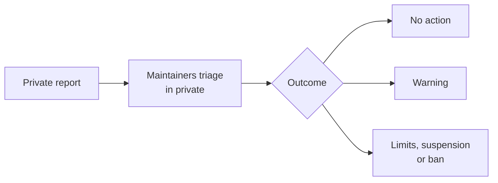

# Code of conduct

Git Crafter adopts the [Contributor Covenant 3.0](https://www.contributor-covenant.org/version/3/0/code_of_conduct/), its newest version (contributor-covenant.org, read 2026-11-10). Its text is the standard here.

| Step | What happens |
|---|---|
| Report conduct | The repo's Security tab, **Report a vulnerability**: the private form [SECURITY.md](SECURITY.md) uses. Start the title with "Conduct" |
| Report platform abuse | GitHub's own report ([GitHub Docs](https://docs.github.com/en/communities/maintaining-your-safety-on-github/reporting-abuse-or-spam), read 2026-11-10). Use **Report content** in the menu of a comment, issue or pull request, or **Block or Report** on a profile |
| Triage | The maintainers read every report and answer in the same private thread |
| Outcome | No action, or a step on the Covenant's ladder: warning, temporarily limited activities, temporary suspension, permanent ban |
| Privacy | The reporter's identity stays private |
