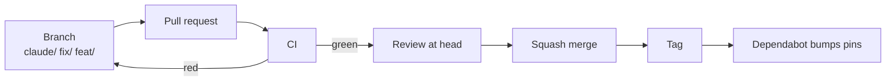

# Contributing

License: [Apache-2.0](LICENSE). Pull requests are welcome; sign off each commit (`git commit -s`) for the [DCO](https://developercertificate.org/) app.



## Where a change goes

| Change | Goes in | Check |
|---|---|---|
| Reusable rule | `rules/*.md` | `voice_lint.py` in `tools/verify.sh` |
| Blocked or allowed command | `tools/bash_guard_rules.json`, with block and allow examples | `bash_guard.py --self-test` |
| One org's name, path, link or number | `config/<org>.json`, never a template file | `public.private_refs`, goal 0 |
| One account's machine, keys tool, checkout or naming | its private overlay, from [config/account.example.json](config/account.example.json); never here | `claude_os_sync.py --self-test` |
| Goal or process-map step | `goals.json`, `maps.json` | `tests/pages-docs.test.mjs` |
| Files installed into `~/.claude` | `manifest.json` | `claude_os_sync.py --self-test` |
| A file another repo needs | a copy there, first lines naming its path and SHA | that repo's CI |
| Collector | `quality/collectors/<tab>/`, helpers in `quality/collectors/lib/`, goals in `quality/targets/` | the `*.test.mjs` beside it |
| Adopter starter | `templates/quality/`, `templates/process/`, `templates/ci/` | `tests/pages-build.test.mjs` |

Other repos send changes by PR too, and keep only [their config and overrides](quality/CONFIG.md).

## Releases

Dependabot moves an adopter's [SHA pin](templates/ci/README.md) to the newest tag. A pin no tag names moves to main's newest commit (docs.github.com, Dependabot supported ecosystems, read 2026-11-03).

| Merged change | Tag |
|---|---|
| Fix: no score, goal or config key changes | patch, `v1.2.1` |
| New metric, tab, ideal, param or goal | minor, `v1.3.0` |
| Config stops loading: key, tab id or metric id renamed or removed | major, `v2.0.0` |
| Metric moved to another tab: a repo with its own `tabs` list loses it until it adds the tab | major, `v2.0.0` |
| Only files the action and `ci-standard.yml` never read: `tools/`, `skills/`, `templates/`, this file | none |

Right after a merge, the orchestrator tags its commit:

```bash
gh api repos/<owner>/git-crafter/git/refs -f ref=refs/tags/v1.3.0 -f sha=<merge sha>
```

After a merge that changes tier 1, it installs the change ([merging skill](skills/merging/SKILL.md)).

## Rules for every PR

| Rule | Source |
|---|---|
| Docs meet the ideal | [quality/ideals/documentation.json](quality/ideals/documentation.json) |
| Conduct follows the Covenant | [CODE_OF_CONDUCT.md](CODE_OF_CONDUCT.md) |
| Visual first, fewest words | [rules/writing-and-gates.md](rules/writing-and-gates.md) |
| No key value in any file, command or log | [rules/keys.md](rules/keys.md), `secret-scan.yml` |
| CI runs the checks, defined in one file | [tools/verify.sh](tools/verify.sh) |
| Outside contributors sign off (`git commit -s`); verified org members skip it | [.github/dco.yml](.github/dco.yml) |
| Squash merge only, after every check passes on the head commit | Repo settings; [rules/delegation.md](rules/delegation.md) |
| A bug, or a fix one small PR closes within a day, is an issue typed Bug or Task | The org's work-tracking rule |
| Anything else is a draft card on the org Project; it becomes an issue, with its area label, when its PR opens | [GitHub Docs: draft issues](https://docs.github.com/en/issues/planning-and-tracking-with-projects/managing-items-in-your-project/adding-items-to-your-project) |
| A card opens with a picture, drawn by `quality/cards/picture.mjs` and pushed to the `cards` branch | [quality/README.md](quality/README.md); `projects.cards_at_a_glance` |
| A PR that fixes an issue says `Closes #n` or `Card: PVTI_id` on one line, so GitHub links them | [GitHub Docs: linking a pull request](https://docs.github.com/en/issues/tracking-your-work-with-issues/using-issues/linking-a-pull-request-to-an-issue) |

Security problems go to [SECURITY.md](SECURITY.md), not a public issue.
