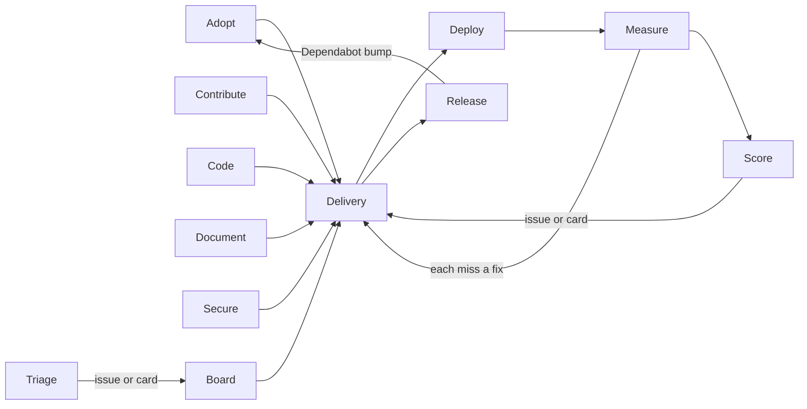

# Git Crafter

Templates for AI agents to run an open-source or open-weight repo with Claude Code or OpenCode. Git Crafter is licensed under [Apache-2.0](LICENSE) and published by SoulCraft. It began as Code-OS by Colorado Startups ([NOTICE](NOTICE)).

| Part | Gives a repo |
|---|---|
| [Quality, Speed and Consumption page](https://soulcraft-org.github.io/git-crafter/quality/) | 13 tabs, each scored against an ideal from current, dated sources |
| [Process page](https://soulcraft-org.github.io/git-crafter/) | Process maps: each step's tool, rule and metric |
| [CI standard](templates/ci/README.md) | One reusable workflow on GitHub's standard hosted runners |
| [Rules](rules/) and [guards](tools/) | What Claude sessions may do, and the `permissions.deny` list and hookify rules that block one-way doors |

Both pages are public.

## Adopt in three steps

| Step | Copy or set | From |
|---|---|---|
| 1 | `<repo>/quality/config.json`, less unused tabs | [templates/quality](templates/quality/README.md) |
| 1 | `<repo>/quality/process/config.json`, with your repo's name | [templates/process](templates/process/README.md) |
| 1 | `<repo>/.github/workflows/ci.yml` and `<repo>/.github/workflows/pages.yml` | [templates/ci](templates/ci/README.md) |
| 1 | `<repo>/.github/dependabot.yml`, which bumps the Git Crafter pin | [templates/ci/dependabot.yml](templates/ci/dependabot.yml) |
| 2 | A ruleset on `main` requiring `ci / ci-ok` | [templates/ci](templates/ci/README.md) |
| 3 | Settings, Pages: source "GitHub Actions" | [templates/ci](templates/ci/README.md) |
| Optional | Community files, switches, agent files, CI pool | [open](templates/open/README.md), [setup.json](templates/setup.json) with `tools/apply_setup.mjs`, [agents](templates/agents/README.md), [CI-POOL.md](templates/ci/CI-POOL.md) |

## The 13 tabs

Each tab scores Quality, Speed and Consumption, a third each, against goals that name their source ([quality/SCORING.md](quality/SCORING.md)). `pages` scores a site, so it is off until a repo's config turns it on.

| Tab ids | What each measures, which to drop |
|---|---|
| `code` `documentation` `issues` `pull-requests` `discussions` `actions` `projects` `security` `dependabot` `scanning` `insights` `settings` `pages` | [templates/quality](templates/quality/README.md) |

## The maps

Each map's steps: [pages/maps](pages/maps/README.md).

## Rules for Claude sessions

| Rule | Loads | Says |
|---|---|---|
| [delegation](rules/delegation.md) | Every turn | Who decides and merges |
| [keys](rules/keys.md) | Every turn | No session handles a key |
| [compute](rules/compute.md) | Every turn | Cloud first, free credits only |
| [writing-and-gates](rules/writing-and-gates.md) | Every turn | Visual docs, plain prose |
| [compute-detail](rules/compute-detail.md), [comfy](rules/comfy.md), [gates](rules/gates.md), [keys-detail](rules/keys-detail.md) | Matching files | CI pool, GPU tiers, gates |
| [merging](skills/merging/SKILL.md) | Reviewing and merging | Merge conditions |

What loads when: the [memory](https://code.claude.com/docs/en/memory) and [skills](https://code.claude.com/docs/en/skills) docs, read 2026-11-03. `tools/claude_os_sync.py apply` copies the rules and guards into `~/.claude` from [manifest.json](manifest.json); [CONTRIBUTING](CONTRIBUTING.md#releases) says when.

## Folder map

| Folder | Holds |
|---|---|
| `actions/` | The `pages` and `ci-pool` actions |
| `config/` | Its Quality config, its collector in `config/quality/collectors/`, and [account.example.json](config/account.example.json) for a private overlay (`apply --overlay DIR`) |
| `pages/` | The Process and Metrics builder and the map library, `pages/maps/` |
| `quality/` | The Quality engine and its collectors ([README](quality/README.md)) |
| `rules/` | Rules for Claude sessions |
| `skills/` | The `merging` skill |
| `templates/` | Starters: `quality/`, `process/`, `ci/`, `open/`, `setup.json`, `agents/` |
| `tests/` | Page and verify tests |
| `tools/` | Guards, lints, sync and the org collector |
| `wiki/` | Wiki pages, published on merge |

## Help

| Need | Go to |
|---|---|
| Help, bugs and ideas | [SUPPORT.md](SUPPORT.md) |
| Changes, and template fixes from adopters | [CONTRIBUTING.md](CONTRIBUTING.md) |
| Security problems | [SECURITY.md](SECURITY.md) |
| Maintainer | SoulCraft, the publisher |
