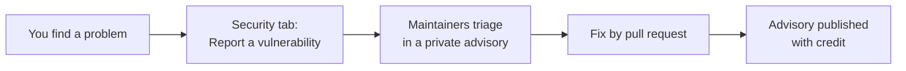

# Security

Git Crafter is licensed under [Apache-2.0](LICENSE) and published by SoulCraft. It began as Code-OS by Colorado Startups ([NOTICE](NOTICE)). Report a security problem privately, never in a public issue.

## Reporting

| Step | How |
|---|---|
| Report | GitHub private vulnerability reporting: the repo's Security tab, **Report a vulnerability**. It is on in the repo's security settings |
| Never | open a public issue for a security problem, or paste a key value anywhere |
| Then | the fix lands by pull request, and the advisory names the reporter unless they ask otherwise |
| Supported | the newest release tag. A fix lands on `main` and ships in the next tag, which Dependabot offers to every repo that pins Git Crafter |

## In scope

| Part | A finding looks like |
|---|---|
| `tools/bash_guard.py` and its rules | A one-way-door command the guard lets through, or a credential read it misses |
| `tools/write_guard.py` | A write the guard should stop and does not |
| `tools/comfy_guard.py` | A Comfy run the guard should deny or ask about and lets through |
| `tools/claude_os_sync.py` | A write outside the paths `manifest.json` and an overlay list |
| `tools/collect_org.mjs` | A read that writes, or a token in `data/` |
| `.github/workflows/` | A step that runs untrusted input, or an unpinned action |
| Any file | A key value, or a private name outside `config/` |

## How Git Crafter stays safe

| Control | Where |
|---|---|
| No session reads, prints or stores a key value | [rules/keys.md](rules/keys.md); the guard's credential, Keychain, clipboard and env rules |
| Every guard rule ships block and allow examples, run as a self-test in CI | [tools/bash_guard_rules.json](tools/bash_guard_rules.json), [tools/verify.sh](tools/verify.sh) |
| gitleaks scans each PR's own commits, and on a push to main every ancestor of the pushed commit, pinned by version and SHA-256. A ruleset requires the check to merge | [secret-scan.yml](.github/workflows/secret-scan.yml), [secret_scan.sh](tools/secret_scan.sh) |
| Workflows default to `contents: read`. Only three jobs write: Pages deploy, the hand-run ruleset probe (throwaway branches) and the Claude review (PR comments). Actions pin by commit SHA; checkouts use `persist-credentials: false`, probe excepted | [.github/workflows/](.github/workflows/) |
| The repo's Actions policy runs only GitHub-owned actions, and only at a full commit SHA | The repo's Settings, Actions, General (set 2026-11-10) |
| Secret scanning with push protection, CodeQL default setup, Dependabot alerts and security updates, and immutable releases are on. Version updates come weekly, one grouped pull request per ecosystem, after a 14-day cooldown | [dependabot.yml](.github/dependabot.yml); the repo's security settings |
| The sync tool writes only the paths the manifest and an overlay list, and only on `apply --yes` | [manifest.json](manifest.json), [tools/claude_os_sync.py](tools/claude_os_sync.py) |
| An org's names live in its own private overlay, never in this repo. The overlay scans this repo's `main` daily for them (goal 0) | [tools/public_scan.py](tools/public_scan.py), [tools/export_public.sh](tools/export_public.sh) |
