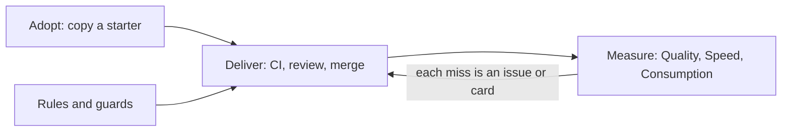

# Git Crafter spec

| Field | Value |
|---|---|
| Status | Draft, 2026-11-25. Waits for the owner's answer on the open choices |
| Repo | `SoulCraft-Org/git-crafter`, public, Apache-2.0 |
| Written from | [README](README.md), [goals.json](goals.json), [CONTRIBUTING](CONTRIBUTING.md) and the open issues. No goal here is new |
| Tracks | #579 |

## Purpose

Give an AI agent what it needs to run an open-source or open-weight repo with Claude Code or OpenCode: rules, templates, guards and score pages. Origin: Code-OS by Colorado Startups ([NOTICE](NOTICE)).

## Goals

| Goal | Measured by |
|---|---|
| Build quality: small changes, green at merge | `goals.json` outcome `build`, 6 goals |
| Production quality: accessible, fast, no open vulnerable dependency | outcome `production`, 5 goals |
| Speed: push to green in about ten minutes | outcome `speed`, 5 goals |
| Consumption: few tokens and minutes | The Consumption score on every tab |
| Nothing private in this public repo | `public.private_refs` at 0 |

## Not goals

| Not | Why |
|---|---|
| One org's names, paths or keys | They go in `config/<org>.json` |
| Running anyone's compute | Rule: [rules/compute.md](rules/compute.md) |

## Parts

| Part | Folder |
|---|---|
| Quality page, one tab per area | `quality/`, `config/` |
| Process page and maps | `pages/` |
| CI standard | `templates/ci/`, `actions/` |
| Rules and guards | `rules/`, `tools/` |
| Starters and merging skill | `templates/`, `skills/` |

## Roadmap, from the open issues

| Theme | Issues |
|---|---|
| User, Org and Enterprise levels | #431 to #468 |
| Auto-merge gated by a review status | #584, #495 |
| Code Project tab and setup template | #567, #587, #549 |
| Free self-hosted CI pool | #590 |

## Open choices

| # | Choice | Recommendation |
|---|---|---|
| 1 | Levels: finish User and Org, hold Enterprise until its trial (#467). Or build all three | Hold Enterprise: it has no user yet |
| 2 | Agents: Claude Code and OpenCode, or Claude Code only | Keep both, as `AGENTS.md` promises |
| 3 | Merge: agents merge on green CI and a review at the head. Or a human gate | Agents merge. Keep a human gate for protection, name and visibility changes |
| 4 | Governance: one maintainer, or a second | One until a second outside PR merges |
