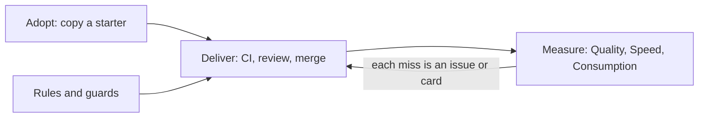

# Git Crafter spec

| Field | Value |
|---|---|
| Status | Draft, 2026-11-25. Not adopted: it waits for the owner's answer on the open choices below |
| Repo | `SoulCraft-Org/git-crafter`, public, Apache-2.0 |
| Written from | [README](README.md), [goals.json](goals.json), [CONTRIBUTING](CONTRIBUTING.md), [THREAT-MODEL](THREAT-MODEL.md), [rules/](rules/) and the open issues. No goal here is new |
| Tracks | #579 |

## Purpose

Give an AI agent everything it needs to run an open-source or open-weight repo with Claude Code or OpenCode: rules, templates, guards and score pages. Origin: Code-OS by Colorado Startups ([NOTICE](NOTICE)).

## Who it serves

| User | Gets |
|---|---|
| A repo owner who lets agents ship | A CI standard, community files, agent files and a score page by copying starters |
| A Claude session in an adopting repo | Rules that load by file, and guards that block one-way doors |
| SoulCraft-Org | The same standard on every repo, with its own settings kept in `config/` |
| An outside contributor | A public repo that takes pull requests |

## Goals

| Goal | Measured by | Source |
|---|---|---|
| Build quality: small changes, green at merge, no PR waiting on a conflict | `goals.json` outcome `build`: 6 goals | `goals.json`, DORA |
| Production quality: accessible, fast, no known vulnerable dependency | outcome `production`: 5 goals | `goals.json`, WCAG 2.2 |
| Speed: push to green in about ten minutes, merged within hours | outcome `speed`: 5 goals | `goals.json` |
| Consumption: as few tokens and minutes as possible | The Consumption score on every tab | [quality/SCORING.md](quality/SCORING.md) |
| Adoption in three steps | The table in the README | [README](README.md) |
| Nothing private in the public repo | `public.private_refs` at 0 | `goals.json` |

## Non-goals

| Not | Why |
|---|---|
| Holding any one org's names, paths or keys | They go in `config/<org>.json` or a private overlay |
| Running anyone's compute | Cloud first, free credits, flat plans ([rules/compute.md](rules/compute.md)) |
| Replacing a repo's own tests | It scores and gates them |

## Parts

| Part | Folder | Done when |
|---|---|---|
| Quality, Speed and Consumption page, 13 tabs | `quality/`, `config/` | Every tab has an ideal, targets and a collector |
| Process page and maps | `pages/` | Each map step names its tool, rule and metric |
| CI standard | `templates/ci/`, `actions/` | One reusable workflow, standard runners |
| Rules and guards | `rules/`, `tools/`, `manifest.json` | Rules load by file. The deny list and hookify rules block one-way doors |
| Starters | `templates/` | Copy, edit, run |
| Merging skill | `skills/merging/` | A merge names its head SHA |

## Roadmap, from the open issues

| Theme | Issues | State |
|---|---|---|
| User, Org and Enterprise levels: tabs, maps, apply to SoulCraft-Org, Colorado-Compute and the user account | #431 to #468 | Planned |
| Auto-merge gated by a review status | #584, #495 | The owner said yes on 2026-11-25. Not built |
| Code Project tab and setup template | #567, #587, #549, #588 | Waits for upstream |
| Free self-hosted CI pool for callers | #590 | Planned |
| Quality page polish | #568, #569, #585 | Planned |

## Open choices

| # | Choice | Options | Recommendation |
|---|---|---|---|
| 1 | Scope of the levels | Finish User and Org, hold Enterprise until the trial (#467). Or build all three now | Finish User and Org first: Enterprise has no user yet |
| 2 | Agents supported | Claude Code first and OpenCode kept working. Or Claude Code only | Keep both: the README and `AGENTS.md` already promise both |
| 3 | Who may merge | Agents merge on green CI and a review at the head. Or a human gate on one-way changes | Agents merge, as the owner decided on 2026-11-25. Keep a human gate for changes to protection, names or visibility |
| 4 | Releases | Tag by the rules in CONTRIBUTING. Or release on a calendar | Keep the rules: adopters pin by tag |
| 5 | Governance | One maintainer, as now. Or add a second maintainer file | One until an outside contributor lands a second merged PR |
