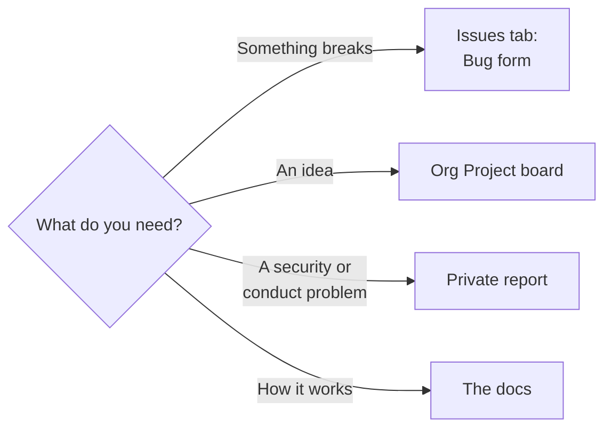

# Support

| Need | Where |
|---|---|
| Report a bug | The Issues tab, **New issue**, the **Bug** form |
| Propose an idea or a feature | The org Project board, as [CONTRIBUTING.md](CONTRIBUTING.md) says |
| Report a security problem | [SECURITY.md](SECURITY.md), never a public issue |
| Report conduct | [CODE_OF_CONDUCT.md](CODE_OF_CONDUCT.md) |
| Contribute a change | [CONTRIBUTING.md](CONTRIBUTING.md) |
| Learn how the pages and scores work | [quality/README.md](quality/README.md) |
