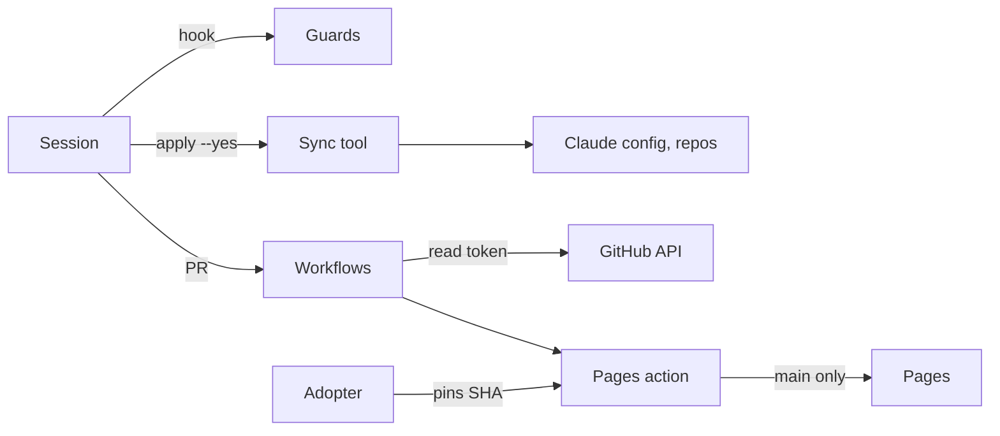

# Threat model

| Read | Covers |
|---|---|
| 2026-11-10 | Every row here and in [tools/THREAT-MODEL.md](tools/THREAT-MODEL.md) (guards, deny rules, sync tool), against `main`; [Microsoft SDL](https://www.microsoft.com/en-us/securityengineering/sdl/practices) practice 3 |
| Each PR | Adds a row for a new threat, secret, write scope or hook |
| Weekly | Re-read against `params.threat_model_covers`; `security.threat_model_current` reads off past its grace goal of 7 days (`threat_model_grace_days`) |

| Element | Threat | STRIDE | Control | Gap |
|---|---|---|---|---|
| [Workflows](.github/workflows/) | PR code gets secrets or writes | Elevation | No `pull_request_target`; read-only by default; only GitHub-owned actions run | None known |
| [Workflows](.github/workflows/) | Action tag moves | Tampering | Full-SHA pins, policy-enforced; 14-day cooldown; a pinned Node, never `lts/*` | None known |
| [Workflows](.github/workflows/) | Secret is committed | Disclosure | gitleaks on PR commits and `main` pushes, required | No Secret Protection (the owner, 2026-11-10) |
| [Workflows](.github/workflows/) | A secret-named file is pushed | Disclosure | Push ruleset 26972270 refuses it. [push-ruleset-proof.yml](.github/workflows/push-ruleset-proof.yml) proves it by real pushes | Proven only as of the last passing hand-run |
| [Workflows](.github/workflows/) | Runs drain the Actions pool | Denial | Timeouts, concurrency, standard runners; fewer Pages jobs | A finite org pool |
| [claude-review.yml](.github/workflows/claude-review.yml), opt-in [template](templates/ci/claude-review.yml) | PR code reaches the review token | Elevation | No `pull_request_target` or forks; `contents: read`; the diff is data | Advisory; sensitive paths only here |
| [actions/pages](actions/pages/action.yml) | Token lands in page data | Disclosure | Token only to `gh`; computed figures, never raw API replies; redacted transcripts | A collector bug |
| [actions/pages](actions/pages/action.yml) | Failed read looks good | Repudiation | Refused reads are not measured | None known |
| [templates/](templates/) | Copied config reads another repo's data | Disclosure | Repo-relative paths; the caller's read token | None known |
| [public_scan.py](tools/public_scan.py) | Private name ships in the public tree | Disclosure | `public-export.yml` and the scan (#397) | Advisory check |
| `main` | Unreviewed change lands | Elevation | Rulesets: a PR, `ci / ci-ok`, `secret-scan`, no force push | One human |

Report findings: [SECURITY.md](SECURITY.md).
