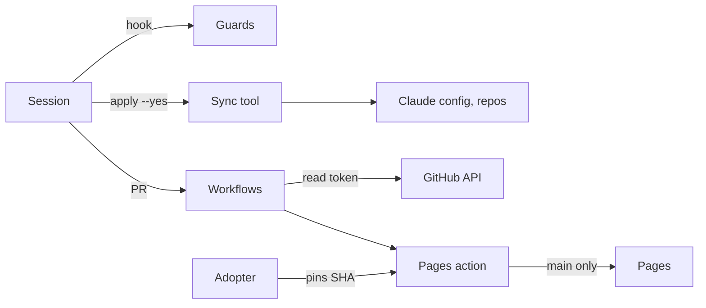

# Threat model

| Read | Covers |
|---|---|
| 2026-11-10 | Every row here and in [tools/THREAT-MODEL.md](tools/THREAT-MODEL.md) (guards, deny rules, sync tool), against `main`; [Microsoft SDL](https://www.microsoft.com/en-us/securityengineering/sdl/practices) practice 3 |
| Each PR | Adds a row for a new threat, secret, write scope or hook |
| Weekly | Re-read against `params.threat_model_covers`; `security.threat_model_current` reads off past its grace goal of 7 days (`threat_model_grace_days`) |

| Element | Threat | STRIDE | Control | Gap |
|---|---|---|---|---|
| [Workflows](.github/workflows/) | PR code gets secrets or writes | Elevation | Read-only by default; each write on one job ([SECURITY.md](SECURITY.md) lists six). `pull_request_target` only in [branch-cleanup.yml](.github/workflows/branch-cleanup.yml): no checkout, event fields through env. The policy allows GitHub-owned and verified creators' actions | branch-cleanup holds `contents: write` on a `pull_request_target` run |
| [Workflows](.github/workflows/) | Action tag moves | Tampering | Full-SHA pins, policy-enforced; 14-day cooldown; a pinned Node, never `lts/*` | `ossf/scorecard-action` is a Docker action. Its pinned commit pulls `ghcr.io/ossf/scorecard-action:v2.5.0` by tag, in a job with `id-token: write`. Scorecard's server refuses a digest-pinned step (scorecard-infra `verify_workflow.go`, read 2026-11-23) |
| [Workflows](.github/workflows/) | Secret is committed | Disclosure | gitleaks on PR commits and `main` pushes, required | No Secret Protection (the owner, 2026-11-10) |
| [Workflows](.github/workflows/) | A secret-named file is pushed | Disclosure | Push ruleset 26972270 refuses it. [push-ruleset-proof.yml](.github/workflows/push-ruleset-proof.yml) proves it by real pushes | Proven only as of the last passing hand-run |
| [Workflows](.github/workflows/) | Runs drain the Actions pool | Denial | Timeouts, concurrency, standard runners; fewer Pages jobs | A finite org pool |
| [claude-review.yml](.github/workflows/claude-review.yml), opt-in [template](templates/ci/claude-review.yml) | PR code reaches the review token | Elevation | No `pull_request_target` or forks; `contents: read`; the diff is data | Advisory; sensitive paths only here |
| [actions/pages](actions/pages/action.yml) | Token lands in page data | Disclosure | Token only to `gh`; computed figures, never raw API replies; redacted transcripts | A collector bug |
| [actions/pages](actions/pages/action.yml) | Failed read looks good | Repudiation | Refused reads are not measured | None known |
| [templates/](templates/) | Copied config reads another repo's data | Disclosure | Repo-relative paths; the caller's read token | None known |
| [public_scan.py](tools/public_scan.py), [private_paths.sh](tools/private_paths.sh) | Private name or path ships in this public repo | Disclosure | `verify` fails on a tracked private path. The overlay scans daily (#397) | The scan is advisory |
| `main` | Unreviewed change lands | Elevation | Rulesets: a PR, `ci / ci-ok`, `secret-scan`, no force push | One human |

## Jobs that write

| Job that writes | Runs on | Writes |
|---|---|---|
| `pages.yml` deploy | Push to main, the daily schedule, or a manual run on main | `contents`, `issues`, `pages` and an OIDC token; an App token with `organization-projects: write` for the board |
| `push-ruleset-proof.yml` probe | By hand | `contents`: throwaway branches |
| `claude-review.yml` review | Same-repo PRs on sensitive paths | `pull-requests`: one comment |
| `branch-cleanup.yml` | `pull_request_target`, closed unmerged | `contents`: deletes the PR's branch; no checkout |
| `wiki.yml` | Push to main touching `wiki/`, or a manual run | `contents`: the wiki's git repo |
| `scorecard.yml` analysis | Weekly and by hand, main only | An OIDC token that signs the published score |
| `codeql.yml` analyze | PRs to main, pushes to main, weekly | `security-events`: the SARIF upload; read-only elsewhere, no build |

Report findings: [SECURITY.md](SECURITY.md).
