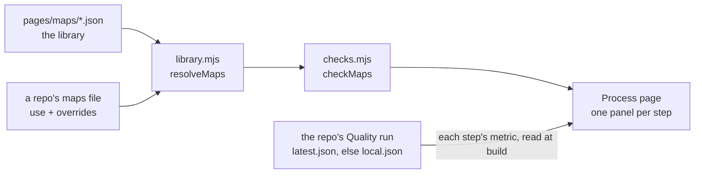

# Process maps

The template's process maps, one `<id>.json` each. Every step names a tool, a rule and one metric on the repo's Quality page. Rest of the format: [quality/README.md](../../quality/README.md).

| Map | Steps, each scored by one template metric |
| --- | --- |
| [delivery.json](delivery.json) | plan, build, check, review, merge |
| [board.json](board.json) | card, split, start, finish, done, watch |
| [deploy.json](deploy.json) | build, ship, verify, restore |
| [guard.json](guard.json) | call, block, message, false alarm, change |
| [adopt.json](adopt.json) | copy, require, update, check, current |
| [measure.json](measure.json) | collect, score, page, goal, fix |
| [code.json](code.json) | measure, simplify, delete, explain, check, hold |
| [triage.json](triage.json) | intake, issue, card, fix, link (a fork: issue and card sit side by side) |
| [secure.json](secure.json) | keys, scan, model, report, alerts |
| [decide.json](decide.json) | arise, decide, queue, clear (a fork: Claude decides or the owner's queue) |
| [document.json](document.json) | write, lint, map, publish, read, load |
| [contribute.json](contribute.json) | idea, approve, review, merge, rebuild, deploy (a fork: merge or rebuild) |

Git Crafter's own [`maps.json`](../../maps.json) adds Spend (free first, read, stay under, drop idle); it reads a local credits registry an adopter's CI lacks, so it is not in the library.

| Rule | Checked by |
| --- | --- |
| an `ideal` and dated `sources` | `checkLibrary`, `pages/build.mjs` |
| at most 6 steps | `MAX_STEPS` |
| a rule of 20 words at most | `MAX_RULE_WORDS`, `checkLibrary` only |
| `rule_ref` an https link | `checkLibrary` |
| a step of each kind: quality, speed and consumption | `checkLibrary`; `tests/pages-build.test.mjs` for a repo's own maps |
| `at: [col, row]` on every step draws a fork; no two steps share a cell | `checkMaps` |
| `time_bar`, optional: one metric whose detail rows are step hours, drawn under the trail as one labelled stacked bar. A step it could not read is listed, never a zero. Delivery's is `lead_time.hours` | `checkMaps`, `tests/pages-build.test.mjs` |
| a step's value comes from the repo's own Quality run when the page builds (`withOwnRun`), never an older copy in `data/org.json`: no step to re-run | `tests/pages-build.test.mjs` |

## In a repo's maps file

| Entry | Effect |
| --- | --- |
| `{ "use": "delivery" }` | the library map as written |
| `{ "use": "delivery", "steps": { "review": { "rule": "…" } } }` | changes `name`, `why`, `ideal`, `sources`, `critical_path`, `time_bar` (null drops it); a step's `name`, `short`, `tools`, `rule`, `rule_ref`, `metric`, `icon`, `gates`, `gates_from`, by step id |
| `{ "use": "delivery", "steps": { "plan": { "drop": true } } }` | the step is off, and leaves the critical path |
| a map with its own `id` and `steps` | the repo's own map |
| an unknown map, step or key | usage error (`pages/library.mjs`) |

A step's metric is an id on the repo's Quality page, read from its own run. A map whose metric sits on a tab the repo drops needs that step dropped too. Git Crafter's `maps.json` is an instance.
