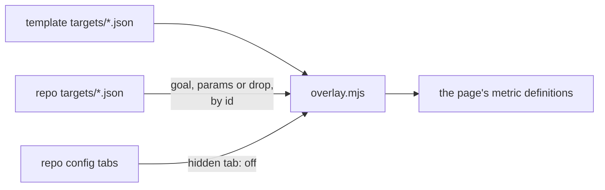

# Repo config and overrides

A repo's page settings (`config.mjs`) and target overrides (`overlay.mjs`). [Back](README.md).

## Repo config

| Key | Default | Means |
| --- | --- | --- |
| `repo` | `GITHUB_REPOSITORY` | `owner/name`, for issue, commit and review links |
| `level` | `"repo"` | `"user"`, `"repo"`, `"org"` or `"enterprise"`; any but `repo` adds the level's [built-in pack](#packs) |
| `owner` | at level `org`, the repo's owner; at level `user`, the signed-in user | the login or enterprise slug a level page measures; level `enterprise` needs it, and level `repo` refuses it |
| `name` | the owner at a level page, else the repo's name | the page title |
| `tabs` | every template tab but `pages`; at a level page, the packs' tabs only | tab ids in order; `["id", "Name"]` adds a tab of the repo's own; a removed id stops ([migration](../templates/quality/README.md#from-v6-to-v7)) |
| `web` | `false` | `true` shows the Pages tab |
| `targets` | `<repo>/quality/targets` | overrides and own metrics |
| `collectors` | `<repo>/quality/collectors` | own collectors; a template collector's name is a usage error |
| `ideals` | `<repo>/quality/ideals` | ideal states, one file per tab, replacing the template's |
| `packs` | `[]` | other repos' tabs and maps ([below](#packs)) |
| `reviews`, `data`, `history`, `out` | `<repo>/quality/<key>`; `out` is `<repo>/quality/dist` | folders |
| `tokens_css` | `render/tokens.css` | page colors |
| `budget` | 1,000,000, per `config.mjs` | page bytes; one over is exit 1 |
| `drop_needs` | `[]` | a metric whose `needs` is listed is off, as `drop` does; an unused value is a usage error |
| `issue_sync` | `null`, off | `{ "label", "labels", "project", "quick", "waiting" }` turns on [`sync-issues.mjs`](sync-issues.mjs): one draft card per missed metric on org project `project`, Todo, or Waiting on data for ids in `waiting`. Ids in `quick` open a Task issue instead, labeled `labels[tab]` or `label`; with no `project`, every id does. Cards need `BOARD_TOKEN` |
| `comment` | | allowed |
| an unknown key | | a usage error |

## Packs

A pack adds another repo's Quality tabs and Process maps ([`packs.mjs`](packs.mjs)). A pack is pinned like an action. `actions/pages` fetches only its `quality-config` file's packs.

| Entry | Means |
| --- | --- |
| `"owner/repo@<40-hex sha>"` | `actions/pages` fetches that commit ([`pack-checkouts.mjs`](pack-checkouts.mjs)) |
| a tag, branch or short SHA | refused: each can move |
| a folder path | `--local` runs only |
| `level:<level>` | built in: `quality/levels/<level>`, added by the `level` key; it ships with the engine, so nothing fetches it |

| Pack file | Adds |
| --- | --- |
| `pack.json` | `{ "tabs": [["id", "Name"]] }`, each id new; a bare id (not `["id", "Name"]`) fails before checkout |
| `targets/`, `ideals/`, `maps/` | beside the template's, never over it |
| `collectors/` | run with `lib` ([contract](collectors/README.md)) |

## Overrides

A repo's `targets/<name>.json` lies over the template's by metric id.

| Entry | Effect |
| --- | --- |
| `{ "id": "ci.pass_rate", "goal": 98, "near": 90, "goal_source": "…" }` | the repo's goal for a template metric |
| `{ "id": "…", "params": { … } }` | merged key by key over the template's params |
| `{ "id": "ci.latest_flow", "params": { "always_run": { "<workflow>": "<why>" } } }` | CI shares leave it out and say why |
| `{ "id": "…", "drop": true }` | off: not shown, not scored; collected only with `gate`. The page counts it and lists its `goal_source` |
| `{ "id": "…", "gate": true }` | a miss fails the repo's pull request ([SCORING.md](SCORING.md)), even with `drop: true` |
| `{ "id": "…", "gate": "warn" }` | a miss warns; the pull request passes |
| an id the template lacks | the repo's own metric, a full definition |
| any other field on a template id | usage error: tab, kind, direction and label stay the template's |
| a collector whose metrics are all off, by `drop` or a hidden tab | does not run |
