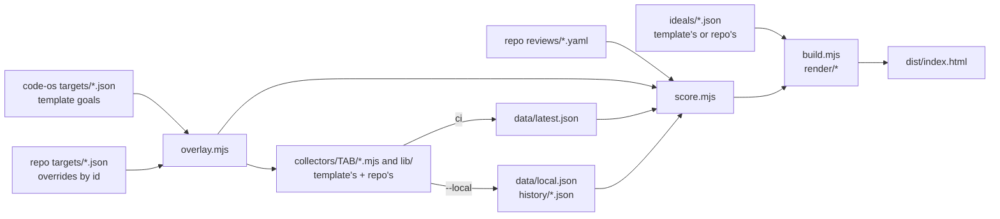

# Quality, Speed and Consumption

One page per repo. A repo copies only a starter config and calls this folder through `actions/pages`.

| Each tab | |
| --- | --- |
| Opens with | its ideal state: the best practice for its area from the most recent documented sources, summarized with links to them |
| Scores | Quality, Speed and Consumption, a third each; the master score is the mean of the three |
| Measures | only a metric that moves the tab toward its ideal, each with a goal and a `goal_source` |

Git Crafter holds the engine, collectors and template goals. A repo holds only its config, the goals it changes, its own collectors and its data.



## In a repo

The call, with this repo's Quality config as the example:

```yaml
- uses: SoulCraft-Org/git-crafter/actions/pages@<full sha> # v4.0.0
  with:
    pages: quality            # or: process quality
    quality-config: config/quality.json
```

| Command | Does | Fires or waits |
| --- | --- | --- |
| `actions/pages`, `pages: quality` | `npm ci`, then `collect.mjs` (ci) and `build.mjs`. Modes `collect` and `render` split it over two jobs. Optional `admin-read-token` reads admin metrics in CI; `hf-token` and `openrouter-api-key` serve a pack's collectors | Fires: the repo's workflow |
| `node <code-os>/quality/collect.mjs --local` | admin, transcript and other local-only metrics into `<data>/local.json` and `<history>/<date>.json`. It runs from a Git Crafter checkout at the repo's pinned SHA. It exits 4 when this hour's quota left is under a full run's last recorded spend. `--only NAME` runs one collector alone | Waits for a session; commit the result by PR |
| `node <code-os>/quality/build.mjs` | render `<out>/index.html`, print its size, exit 1 over the budget | Either |
| `node quality/selftest.mjs` | the engine's self-test, which runs `render/*.test.mjs` | Fires: `tools/verify.sh` in CI |
| `node <code-os>/quality/cards/picture.mjs spec.json > card.svg` | a board card's picture: its pillar, a meter from now to goal, its steps. Push the file to the repo's `cards` branch and link it from the card as `https://github.com/<owner>/<repo>/raw/cards/<file>.svg` | Waits for a session adding or changing a card |

Every command runs in the repo's root. It reads `<repo>/quality/config.json`, or the file `--config` names.

`collect.mjs` reads `gh api rate_limit` before and after, and logs limit, used, left and spent. Under `params.api_reserve` in `targets/ci.json` (300, a goal), collectors exporting `githubApi` skip; their metrics read `could_not_check`, `api reserve`.

## The format

| Doc | Covers |
| --- | --- |
| [CONFIG.md](CONFIG.md) | the repo config's keys, and how a repo's targets override the template's |
| [collectors/README.md](collectors/README.md) | the collector contract: arguments, returns, targets files |
| [render/README.md](render/README.md) | charts, display fields and run files |
| [ideals/README.md](ideals/README.md) | ideal states and review files |
| [SCORING.md](SCORING.md) | scores, gates and exit codes |
| [../pages/maps/README.md](../pages/maps/README.md) | the Process page's map library |
