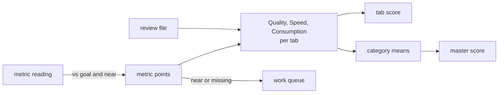
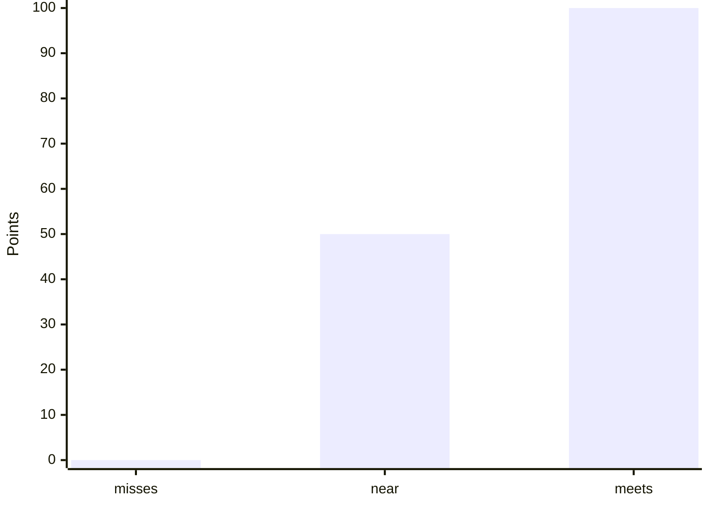

# Scoring, gates and exit codes

How the page turns readings into scores, and when a run fails. Back to [README.md](README.md).

## Scores

| Rule | Where |
| --- | --- |
| Metric vs goal → 100 meets, 50 near, 0 misses | `scoreMetric()` |
| Not measured → left out, shown as "n of m measured", never 0 | `scoreTab()`; the self-test fails if it counts as 0 |
| Quality = mean(metrics) and review score, half each; the review alone when no metric is measured | `scoreTab()` |
| Review score = mean item score 1 to 5 → 0 to 100 | `loadReviews()` |
| Overall quality, speed and consumption = each the mean of the tabs' scores in that category that are not null, each tab weighted equally | `overall()` and `master()` in `render/model.mjs` |
| Master score out of 100 = the mean of Quality, Speed and Consumption, a third each | `master()` in `render/model.mjs` |
| A tab = the mean of its three categories | `master()` |
| Work queue = every metric near or missing its goal, ranked by the master points it adds | `workQueue()` in `render/model.mjs` |

## Gates

A targets entry may set `gate: true`: a reading worse than the goal is a problem the repo must fix. `gate: "warn"` only flags it, for what a tool calls a heuristic ([`rules/gates.md`](../rules/gates.md)).

| Step | What happens |
| --- | --- |
| `collect.mjs` | writes the run, names each detail row and exits 3; a `"warn"` miss prints a `::warning::` and exits 0 |
| `actions/pages` | still builds the pages (mode all) or uploads the run (mode collect) |
| Then | fails a pull request or merge queue run; a push publishes the page |
| A dropped metric | may still gate: it is collected and checked, but stays off the page and out of the score |
| The template's one gate | `docs.unmapped`, so a repo's `pull_request` trigger must include its doc globs. A repo's override may gate any other metric ([CONFIG.md](CONFIG.md)). Git Crafter blocks on twelve Code counts, four of them unscored, and warns on four unused-code counts. `code-gate` in `pages.yml` runs them. Git Crafter's own `docs-gate` job also runs `quality/docs-gate.mjs`. It fails a changed doc that crosses the reading goal, drops under the visual bar or gains a markup fault, against its base copy |

## Exit codes

| Code | `build.mjs`, `selftest.mjs` | `collect.mjs` |
| --- | --- | --- |
| 0 | done | done |
| 1 | self-test failed, or page over budget (`build.mjs` still writes it) | |
| 2 | usage error | usage error |
| 3 | nothing to render (`build.mjs` with no data file) | the run is written, but a gate metric missed its goal |
