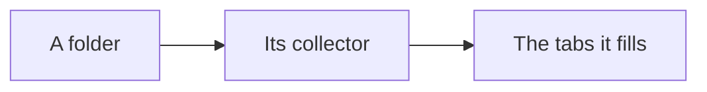

# Collector folders

One folder per collector, each a code area of its own. The contract is in [README.md](README.md).

| Folder | Collector | Fills the tabs |
| --- | --- | --- |
| `ci/` | `ci.mjs` | Actions, Pull requests, Issues, Projects, Security and quality, Insights |
| `code/` | `code.mjs` | Code, Tests |
| `docs/` | `docs.mjs` | Documentation |
| `github/` | `github.mjs` | Issues, Pull requests, Security and quality, Actions, Projects |
| `insights/` | `insights.mjs` | Insights |
| `lib/` | shared helpers, no collector | none |
| `settings/` | `repo-settings.mjs` | Settings |
| `site/` | `deploy.mjs`, `design.mjs`, `usability.mjs` | Deploy, Design, Usability |
| `tests/` | `tests.mjs` | Tests |
| `tools/` | `tools.mjs` | Tools |
