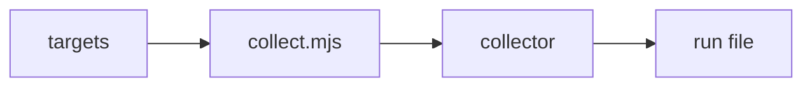

# Collector contract

What a collector here or in a repo's collectors folder takes and returns. Up: [../README.md](../README.md); charts and run files: [../render/README.md](../render/README.md); folders: [FOLDERS.md](FOLDERS.md).

## Contract

| Part | Shape |
| --- | --- |
| Module | `export const area`; `export const scope`, the level or levels it runs at (unset: `repo`); `export async function collect(args)`, args as below |
| Sample | `--sample` reads `<collector>.sample.json` beside it, not `collect()`: no API call, each entry and the run `sample: true` |
| Repo values | only from `params`: owner and repo, paths, URLs, project folders, the template's as defaults for tests and a bare call. Never the repo's targets folder |
| Returns | `{ [id]: { value, detail?: [{ label, value, unit? }], source, read_at } }`, or `{ [id]: { could_not_check or not_applicable, source } }` |
| Never | throws for a missing tool, token or file, or scores a miss as 0. No org name, person's name or home path: those go in `params` |
| Private membership | `pull_requests.reviewed` and `pull_requests.fixed_after_review` count `Review: MERGE\|BLOCK` comments from members only. To a token outside the org, a private member reads as non-member; when any verdict reads so, each is `could_not_check`, never 0. Fix: a public membership, or a token in the org |
| Basis | A state read now, the latest event, or the last N events where new work replaces old within hours; never a calendar window or projection. `source` says which, with N and why |
| Stale input | A metric read from a build output older than its source is not measured |
| Failure | Throwing or failing to import marks every metric in its targets file `could_not_check` |
| Packages | `yaml` and `typescript`, from Git Crafter's root `package.json`; a repo's own collector's, from the repo |
| Layout | `collectors/<collector>/`, one code area each; `collectors/lib/`, the engine's one door. `collect.mjs` runs any `*.mjs` exporting `collect()`, at the top or one subfolder down |
| Test | `collectors/<collector>/<area>.test.mjs` under `node --test`, fixtures in `fixtures/<area>/`: a good fixture and a missing input |

## Arguments

| Argument | Is |
| --- | --- |
| `root` | the repo measured, absolute. Never Git Crafter's checkout: resolve nothing in the repo from `import.meta.url` |
| `mode` | `ci` or `local` |
| `level`, `owner` | the config's: a level its `scope` names, and the account measured |
| `data` | the config's `data` folder, absolute, for files a session writes |
| `params` | always an object: its targets file's `params`, the template's, then the repo's override key by key |
| `targets` | that file's active entries |
| `allParams` | each targets file's merged `params` by file name (`allParams["docs.json"]`): another tab's setting, never a copy that drifts |
| `lib` | engine helpers ([`lib/index.mjs`](lib/index.mjs)) |

## Targets files

`targets/<collector file name>.json`: `collectors/github/github.mjs` reads `targets/github.json`. Each entry:

| Field | Shape |
| --- | --- |
| `id`, `tab`, `label`, `unit` | the metric |
| `kind` | quality: correct; speed: time; consumption: a resource used, tokens, billed minutes, dollars, Worker CPU or bytes shipped |
| `goal`, `near`, `direction` | `near` sits on the worse side of `goal` |
| `goal_source` | required |
| `source`, `needs`, `chart` | where it is read, what it needs, how it draws ([charts](../render/README.md)) |
