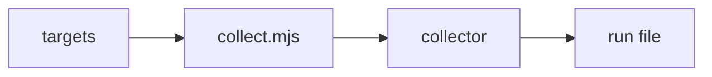

# Collector contract

What a collector here, or in a repo's own collectors folder, takes and returns. Back to [../README.md](../README.md); charts and run files: [../render/README.md](../render/README.md); folders: [FOLDERS.md](FOLDERS.md).

## Contract

| Part | Shape |
| --- | --- |
| Module | `export const area`; `export async function collect(args)`, args as below |
| Repo values | read only from `params`: owner and repo, paths, URLs, project folders. The template's own `params` are the defaults, for tests and a bare call. A collector never reads the repo's targets folder itself |
| Returns | `{ [id]: { value, detail?: [{ label, value, unit? }], source, read_at } }` or `{ [id]: { could_not_check, source } }` |
| Never | throws for a missing tool, token or file, or scores a miss as 0. It holds no org name, person's name or home path: those go in `params` |
| Private membership | `pull_requests.reviewed` counts `Review: MERGE\|BLOCK` comments from members only. A private org membership reads as non-member to a token outside the org. When every verdict reads so, the metric is `could_not_check`, never 0. Fix: a public membership, or a token in the org |
| Basis | Each metric is a state read now, the latest event, or the last N events where new work replaces old within hours. Never a calendar window or a projection. Its `source` says which, and names N and why |
| Stale input | A metric read from a build output is not measured when that output is older than its source |
| Failure | A collector that throws or fails to import marks every metric in its targets file `could_not_check` |
| Packages | `yaml` and `typescript`, from Git Crafter's root `package.json`. A repo's own collector resolves its packages from the repo |
| Layout | one subfolder per tab, `collectors/<tab>/`, each its own code area; the engine's one door, `collectors/lib/`. `collect.mjs` runs any `*.mjs` that exports `collect()`, at the top or one subfolder down |
| Test | `collectors/<tab>/<area>.test.mjs` under `node --test`, fixtures in `fixtures/<area>/`: a good fixture and a missing input |

## Arguments

| Argument | Is |
| --- | --- |
| `root` | the repo measured, absolute. Never Git Crafter's checkout: resolve nothing in the repo from `import.meta.url` |
| `mode` | `ci` or `local` |
| `data` | the repo's data folder (config `data`), absolute, for a file a session writes there |
| `params` | always an object: the union of its targets file's `params`, the template's first, then the repo's override, key by key |
| `targets` | that file's active entries |
| `allParams` | every targets file's merged `params` by file name (`allParams["docs.json"]`), for a setting another tab owns, so no copy drifts |
| `lib` | engine helpers ([`lib/index.mjs`](lib/index.mjs)) |

## Targets files

`targets/<collector file name>.json`: `collectors/github/github.mjs` reads `targets/github.json`. Each entry:

| Field | Shape |
| --- | --- |
| `id`, `tab`, `label`, `unit` | the metric |
| `kind` | quality: correct; speed: time; consumption: a resource used, tokens, billed minutes, dollars, Worker CPU or bytes shipped |
| `goal`, `near`, `direction` | `near` sits on the worse side of `goal` |
| `goal_source` | required |
| `source`, `needs`, `chart` | where it is read, what it needs, how it draws ([charts](../render/README.md)) |
