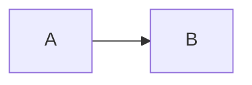
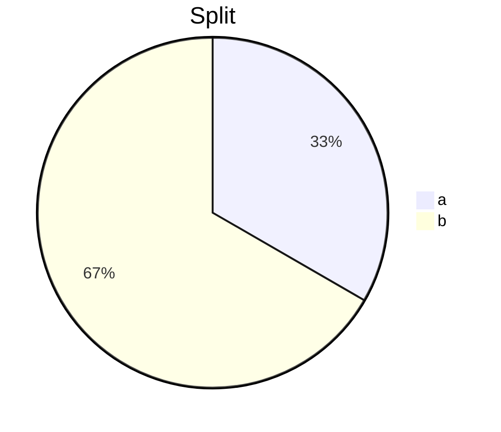
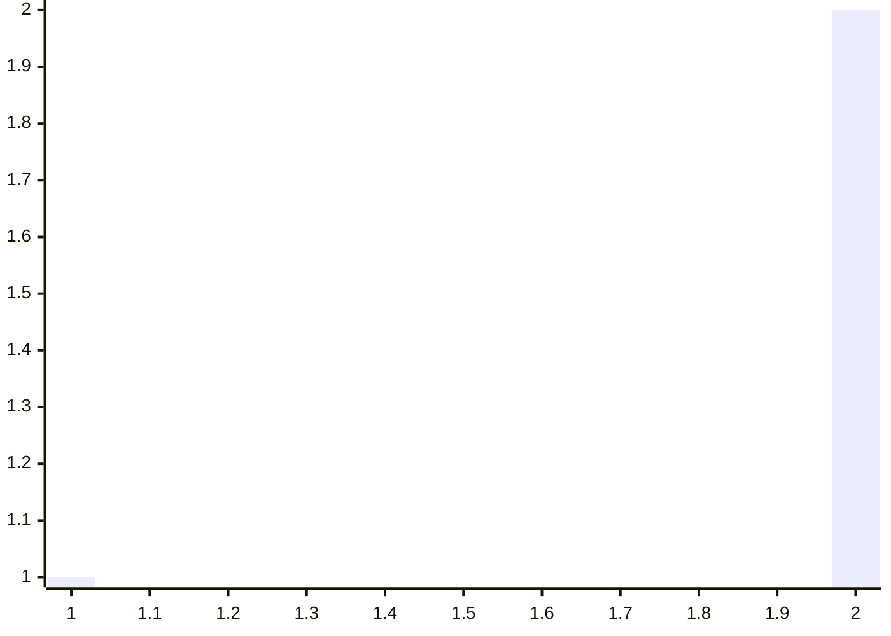

# Interactive

- [ ] open task
- [x] done task

<details>
<summary>More</summary>

Hidden text.

</details>

| Doc | Link |
| --- | --- |
| Setup | [setup](../guide/setup.md) |
| Plain | none |







```text
click A "https://example.com"
<details>
- [ ] not a task
```
