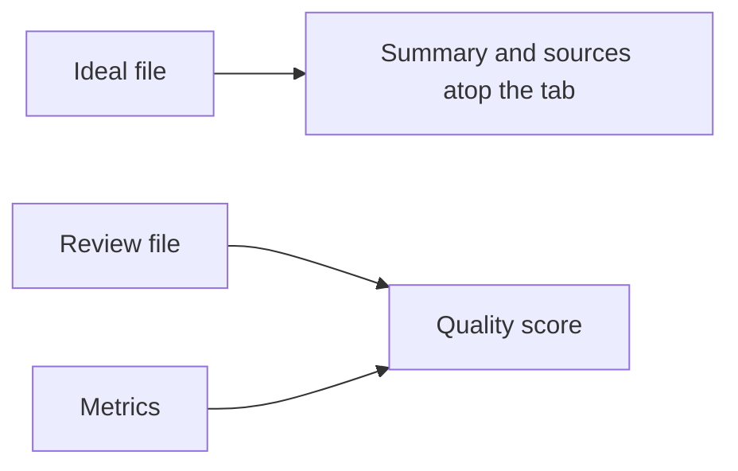

# Ideal states and review files

What a tab is held to, and how a person's review scores it. Back to [../README.md](../README.md).

## Ideal states

`ideals/<tab>.json`, one per tab: the template's in this folder, a repo's in its `ideals` folder in place of the template's.

| Field | Shape |
| --- | --- |
| `ideal` | required, 1 to 300 characters and at most 25 words: the best practice for the tab's area, in plain words. A word is a run of letters, one per 20 letters rounded up: `least-privilege` counts two, numbers none |
| `sources` | required, one or more `{ "title", "url", "date" }`, newest documents preferred. The page lists them numbered under the summary and the parts table, the title as the link, the date beside it |
| `sources[].url` | a public `https` link |
| `sources[].date` | `YYYY-MM-DD`: the document's published or last-updated date, or the day it was read when it shows none |
| `quality`, `speed`, `consumption` | optional, up to 160 characters and 25 words each: what ideal looks like in that category, shown atop its section |
| `parts` | optional, 1 to 8 rows of `{ "part", "ideal", "setup" }`. `part` names a piece of the tab's area, in up to 30 characters. `ideal` and `setup` say what ideal looks like there and how to set it up, in up to 160 characters and 25 words each. Shown as a table under the summary |

| Rule | Holds for | Shape |
| --- | --- | --- |
| Plain words | `ideal`, each category line, each `sources[].title`, every `parts` field | letters in any script, digits, spaces and `,.;:'()%/+?!-`. At least one letter and no edge space. No markup, entities, double quotes or em dashes. An accent follows a letter only; invisible characters are refused, look-alike letters pass. |
| Public link | `sources[].url` | `https` to a plain host name: no punycode, port or credentials, only URL-safe characters after the host. |

| Case | Result |
| --- | --- |
| Any other key, or a file for a tab no list knows | a usage error |
| A tab the template fills lacks its ideal, or a metric in any of the three categories | the self-test fails |
| A repo's build | names each gap on the page and in its log |

## Review files

`reviews/<tab>-YYYY-MM.yaml`, in the repo.

| Field | Shape |
| --- | --- |
| Top | `review` (a tab id), `date` (`YYYY-MM-DD`, required), `commit`, `reviewer`, `rubric`, `items` |
| Item | `page`, `width`, `criterion`, `score` (1 to 5), `finding`, `fix`, `evidence`, `tracking` (issue number or null), optional `level` |
| `level: area` | When any item has it, only those rows score; the rest are findings shown in the table |

| Case | Result |
| --- | --- |
| The newest per tab | scores today |
| Each run in the trend | is scored with the newest review dated on or before it |
| An unknown `review` tab or a score outside 1 to 5 | a usage error |
| A review of a template tab the repo hides | stays off its page |
