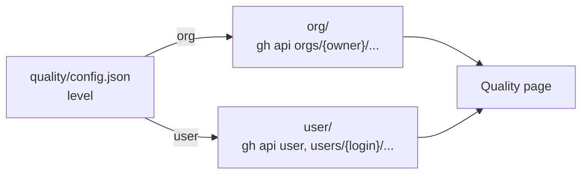

# Level packs

The built-in packs a page at `level` `user` or `org` reads ([`../packs.mjs`](../packs.mjs), [config](../CONFIG.md#repo-config)). Each is a [pack](../CONFIG.md#packs) with no pin. Level `enterprise` has no pack yet.

| Level | Tab | Quality metrics | Reads |
|---|---|---|---|
| org | Org security | 2FA required; security configuration default for new repos | `orgs/{org}`, `orgs/{org}/code-security/configurations/defaults` |
| org | Org rules | rulesets on every repo; default branch guarded | `orgs/{org}/rulesets`, each in full |
| org | Org members | members without 2FA, a count; base permission none or read | `orgs/{org}/members?filter=2fa_disabled`, `orgs/{org}` |
| user | Account security | 2FA on; GPG or SSH signing keys | `user`, `users/{login}/gpg_keys`, `users/{login}/ssh_signing_keys` |
| user | Email privacy | primary email private; personal emails in the latest 100 commits | `user/emails`, `search/commits` |

Each tab also scores the read's seconds (speed) and its requests (consumption). Each pack has one map in `maps/`, with a step on every tab.

## Tokens

| Read | Needs | Without it |
|---|---|---|
| Org settings, 2FA filter | an org owner's token with `admin:org` | not measured, never 0 |
| Security configuration defaults | an owner's or security manager's token with `read:org` | not measured |
| Org rulesets | GitHub Team or Enterprise | not measured |
| User 2FA, emails | the user's own token; emails need `user:email` | not measured |

In CI a collector reads with `ADMIN_READ_TOKEN` when the workflow passes one.

## Not readable

| Setting | Why |
|---|---|
| Block command line pushes that expose my email | no REST field; the commit email count shows its effect |
| Vigilant mode | no REST field |
| Stale personal access tokens | no REST endpoint lists a user's own tokens |

Sources: GitHub Docs pages each target names, read 2026-11-26.
