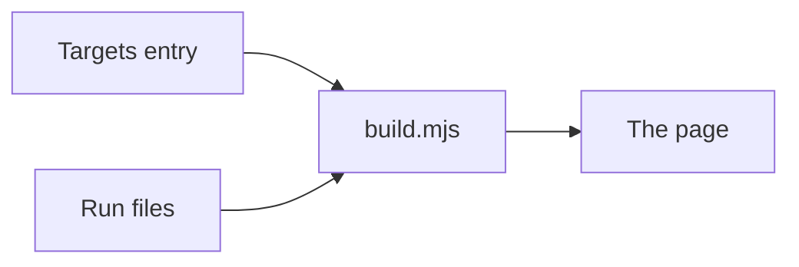

# Charts, display fields and run files

How a metric draws on the page, and what the run files keep. Back to [../README.md](../README.md); the collector contract is in [../collectors/README.md](../collectors/README.md).

## Charts

A targets entry's `chart`. Anything else is a usage error. An entry may add `by_repo` (repo name to value).

| `chart` | Draws | Detail rows carry |
| --- | --- | --- |
| `spark` | a line | |
| `bar`, `gauge` | bars | |
| `number`, `table` | plain rows | |
| `funnel` | ordered stages, largest first, each with its share of the first | |
| `stack` | parts of one whole, at most 5, as one bar that sums to the whole | |
| `flow` | pipeline stages in order, full width, by [ci-flow.mjs](ci-flow.mjs) | `stage`, `kind`, `runs`, `file`, `pass_rate` |
| `ledger` | one row per blocker, full width, by [ledger.mjs](ledger.mjs) | `group`, `fires`, `false_alarm`, `hours`, `tokens`, `verdict` |
| `repos` | one row per repo, by [repos.mjs](repos.mjs) | `value` tokens, `share`, `merged`, `per_10m`, `tokens_per_pr`, `cache_read_share`, `waste_share`, `rework_per_pr`, `per_hour` |
| `deploys` | one row per production deploy, by [deploys.mjs](deploys.mjs) | `value` merges shipped, `commit`, `commit_from`, `lead_hours`, `rollback`, `failed`, `restore_hours` |
| `credits` | one row per allowance, by [credits.mjs](credits.mjs) | `allowance`, `used`, `used_floor`, `unused`, `used_share`, `pool`, `resets`, `status`, `replaces`, `could_take_over`, `claim_needs` |
| `tools` | one row per direct dependency, by [tools.mjs](tools.mjs) | `installed`, `eligible`, `newest`, `status`, `majors_behind`, `waiting_days`, `where` |

## Display fields

| Field | Shape |
| --- | --- |
| `means` | optional: what the number counts, in plain words, no figures, at most 120 characters |
| `group` | optional: a sentence-case sub-heading inside its kind, at most 30 characters. Display only |
| `defined` | optional `YYYY-MM-DD`, not after today: the day the metric's meaning last changed under the same id. Its week-by-week line leaves out reads dated before it and says how many |
| detail `unit` | each item takes the metric's unit unless it sets its own (`''` for a plain count) |
| detail `partial` | a weekly series ends at the last complete week, unless its last item sets `partial: true` |

## Run files

| Subject | Rule |
| --- | --- |
| `latest.json`, `local.json` and each history file | hold one entry per current definition |
| A metric the template cut or the repo dropped | is never written |
| An entry without a value | carries its `could_not_check` reason |
| `build.mjs` | reads older files through the same filter and never rewrites them |
| A metric on a tab the repo hides | is not kept either, so its trend has a gap if the tab comes back |
| Each entry written | records its definition's `unit` |
| The week-by-week line | leaves out a read in another unit, and an older read with no unit once any read shows the unit changed |
