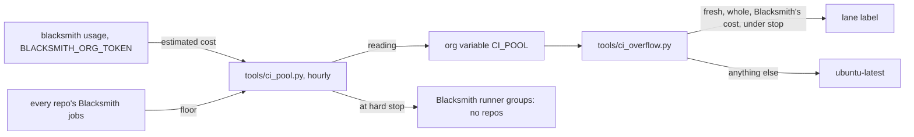

# The CI pool

One meter per org reads Blacksmith's estimated cost against its $12 monthly credit. Every repo's chooser reads the reading, `vars.CI_POOL`, with no token. [DECISIONS.md](DECISIONS.md) has the units.

## Set up

| Do | How |
| --- | --- |
| App | create it from [`ci-pool-app.json`](ci-pool-app.json) and install it on all repos: Actions read, org Variables write, org Self-hosted runners write, no webhook |
| Meter | copy [`ci-pool.yml`](ci-pool.yml) to `<org>/.github/.github/workflows/`, pinned to the first release with `actions/ci-pool` |
| Variable | `CI_POOL_APP_CLIENT_ID`, the App's client id, at the org |
| Secrets | `CI_POOL_APP_KEY`, the App's private key, in the `.github` repo. `BLACKSMITH_ORG_TOKEN` in that repo's environment `ci-pool-meter`: without it, no chooser takes Blacksmith |
| Runner groups | each Blacksmith group's name starts with `Blacksmith` |
| Resume | run `ci-pool` by hand with `resume` ticked; the groups go back to all repos |
| Repos | `CI_OVERFLOW_RUNNER` set to a lane label, at the org or the repo, and the `runner` job in the [README](README.md#overflow-switch) |
| Reading | version 3, in dollars; `complete: false` until the meter has caught up or with no cost from Blacksmith; stale after 75 minutes |

## Decisions

| Date | Decision | Reverse |
| --- | --- | --- |
| 2026-11-20 | One meter per org replaces per-repo shares. Blacksmith's own estimated cost leads. `tools/ci_pool.py` also walks every repo's Blacksmith jobs over a rolling 31 days, weighed as Blacksmith bills them; that floor wins when higher. A chooser needs a version 3 reading under 75 minutes old. It must be complete, carry Blacksmith's cost, and sit under its stop | Delete `CI_POOL`; each lane's `repos` meters one repo again |
| 2026-11-20 | Blacksmith has no spending cap and bills past the free credit with no card on file (the owner, 2026-11-20). So at the hard stop the meter sets every runner group named `Blacksmith*` to selected repos with none, on every pass until `resume`. GitHub's org-wide self-hosted runner switch stays untouched | Run `ci-pool` with `resume`, or raise `hard-stop` |
| 2026-11-20 | `actions/ci-pool` is a composite action that runs `tools/ci_pool.py` at the caller's pin, as `actions/pages` does. A reusable workflow would embed nearly 400 lines in every change | Embed it in a reusable workflow |
| 2026-11-20 | Blacksmith's CLI installs from an unpinned script, so it runs in its own job and hands its cost over as data. Its install path and JSON keys are unverified until the first real run | Drop the `usage` job; no chooser takes Blacksmith |
| 2026-11-20 | The `blacksmith` rule, which no exception waives, fails a Blacksmith label outside the chooser. It fails a sticky disk or Docker layer cache action too, since no meter stops their storage | Drop the rule from `ci_standard_rules.py` |
