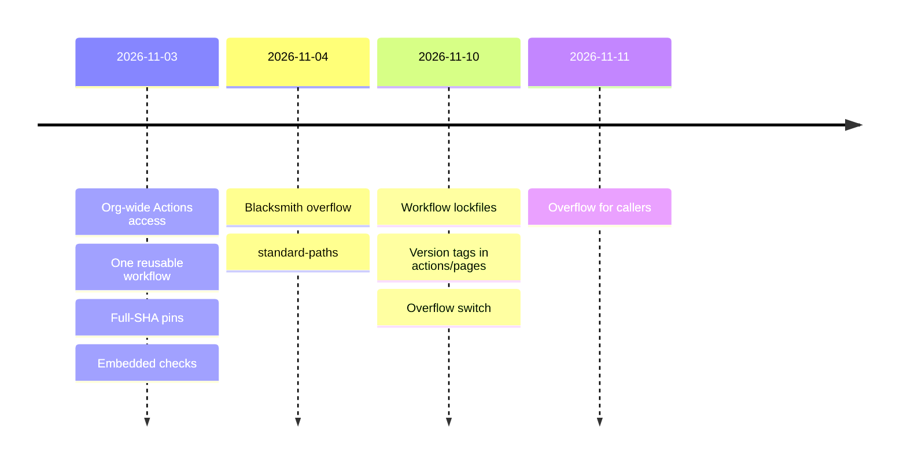

# CI standard decisions

Why the [CI standard](README.md) is built as it is. Each row says how to reverse it.

| Date | Decision | Reverse |
| --- | --- | --- |
| 2026-11-03 | Actions access `organization`: private repos call it tokenless | Set `none` |
| 2026-11-03 | One reusable workflow; no copies, which drift | Repos keep their own workflows |
| 2026-11-03 | Pin by full SHA with `# v1`; Dependabot moves it ([secure use](https://docs.github.com/en/actions/reference/security/secure-use)) | Pin a tag |
| 2026-11-10 | A repo may lock its workflows: `gh extension install github/gh-actions-lock`, `gh actions-lock`, commit `actions.lock` ([lockfiles](https://docs.github.com/en/actions/concepts/security/workflow-dependency-lockfiles)). The call to `ci-standard.yml` stays a SHA: a lockfile covers steps only | Delete `actions.lock` and restore the SHA pins |
| 2026-11-10 | `actions/pages` names its two actions by full version tag: GitHub's runner matches a lockfile by the reference's text, so a SHA there fails this repo's runs. A caller that requires SHA pins locks its workflows first | Take `pages.yml` out of `actions.lock` and restore both SHA pins |
| 2026-11-03 | Checks embedded, since squash merges drop a pinned branch commit | Move them to an action |
| 2026-11-04 | Blacksmith's free tier takes the overflow once the meter and its Apps exist (the owner, 2026-11-03; code-os#200) | GitHub's pool only |
| 2026-11-04 | `standard-paths` skips the standard job when its paths did not change (#189) | Drop the input |
| 2026-11-10 | The overflow switch: `pages.yml`'s `ubuntu-latest` jobs, less `deploy`, take the `runner` job's label. Off by default ([README](README.md#overflow-switch)) | Unset `CI_OVERFLOW_RUNNER` |
| 2026-11-10 | The meter stops Blacksmith at 2,700 of its 3,000 free minutes a month ([runner docs](https://docs.blacksmith.sh/blacksmith-runners/overview), read 2026-11-10). It reads this repo's runs of `workflows` with the workflow token (`actions: read`), each job rounded up to the minute and weighted by vCPUs, per cycle from `cycle_day`. State: an artifact from `main` only, kept 35 days. API calls: at most 400 on `main` and 80 on a pull request; a larger backlog means `ubuntu-latest` | Raise `stop` in `.github/ci-overflow.json` |
| 2026-11-10 | Unverified: Blacksmith's free-minute cycle is assumed to start on the 1st (`cycle_day: 1`). Its 3,000 minutes are per organization, and the meter counts this repo only. That is safe while this is the only repo with the switch | Set `cycle_day` from Blacksmith's billing page; a second repo needs an org-wide meter first |
| 2026-11-11 | Any caller of `ci-standard.yml` can take the lane. `ci-overflow.yml` embeds the same meter and lanes. Its label goes to the `runner` input, which only the standard job reads. A caller grants `actions: read` to its own `runner` job, since a called workflow never gets more than its caller grants. This repo's `verify.yml` opts in and meters `pages.yml` with it. Off by default | Drop the `runner` job and input |
| 2026-11-11 | A lane serves only its `repos`, now none. The meter reads one repo of a per-organization pool | Add a repo once an org-wide meter counts it |
