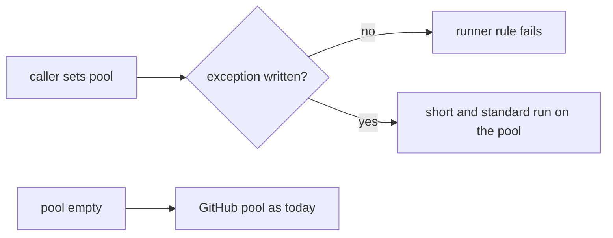

# Free pool input

`ci-standard.yml` takes a `pool` input: one self-hosted runner label for its `short` and `standard` jobs.

| Fact | Detail |
| --- | --- |
| Input | `pool: <label>` on the `ci-standard.yml` call. Empty runs on GitHub's pool, as before |
| Effect | `short` and `standard` run on that label, ahead of the [overflow switch](README.md#overflow-switch) |
| Rule | A caller that sets it fails the `runner` rule until `.github/ci-standard.json` holds an exception for its job (`ci.yml/ci`) with a reason |
| Not covered | The pool's health. A job that finds no runner waits, up to GitHub's 24-hour queue limit, so the caller plans its own fallback |

| Date | Decision | Reverse |
| --- | --- | --- |
| 2026-11-25 | Add `pool`. Free and subsidized lanes only, never pay per use (the owner, 2026-11-25), so an org with no included minutes left runs CI on its own free pool. The coordinator of the owner's project decided it, since this repo is the owner's | Drop the input, the `short` runs-on and the rule's pool finding |
| 2026-11-25 | The caller passes the label. The rule can then see it, and a pull request cannot change an org variable | Read a `vars` value in `runs-on` |
| 2026-11-25 | `pool` ranks above the Blacksmith lane. A free pool costs nothing and the lane is metered | Swap the two in `runs-on` |
