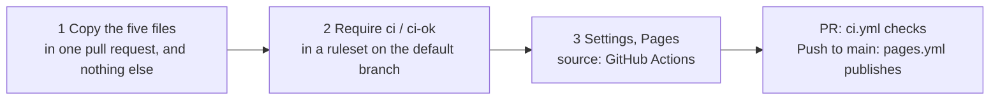
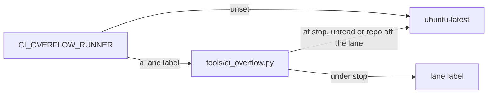

# The CI standard

| What | Holds |
| --- | --- |
| A repo's CI | runs through one reusable workflow, [ci-standard.yml](../../.github/workflows/ci-standard.yml), on free and included minutes only (the owner, 2026-11-02) |
| The workflow's checks | [ci_standard.py](../../tools/ci_standard.py), with exit codes and exceptions, and the parser and rules it imports. All three are embedded verbatim. |
| Where this page and `rules/compute-detail.md` disagree | the rule wins |
| Each dated decision, with how to reverse it | [DECISIONS.md](DECISIONS.md) |

## Adopt Git Crafter

| File | Copy to | Then |
| --- | --- | --- |
| [templates/quality/config.json](../quality/config.json) | `<repo>/quality/config.json` | drop unused tabs ([table](../quality/README.md)) |
| [templates/process/config.json](../process/config.json) | `<repo>/quality/process/config.json` | set `repos`, `repo_url` and `heading` |
| [ci.yml](ci.yml) | `<repo>/.github/workflows/ci.yml` | set `paths`, `short` and `standard` |
| [pages.yml](pages.yml) | `<repo>/.github/workflows/pages.yml` | add the repo's doc globs to its `pull_request` paths |
| [dependabot.yml](dependabot.yml) | `<repo>/.github/dependabot.yml` | or add its `github-actions` entry to the repo's own; it bumps both Git Crafter pins together |

[pages.yml](pages.yml) calls `actions/pages` with `pages: process quality` and both configs. It builds on a pull request and publishes only from `main`.

## Jobs

| Job | Runner | Does |
| --- | --- | --- |
| `changes` | `ubuntu-slim` | The `paths` and `standard-paths` filters, then the conformance check |
| `short` | `ubuntu-slim` | The `short` commands, under 15 minutes (the `short` input's limit in ci-standard.yml, read 2026-11-04), no Docker |
| `standard` | `ubuntu-latest` | The `standard` commands, when the change touched `standard-paths` (default `paths`) |
| `ci-ok` | `ubuntu-slim` | Fails on a failed job, a failed check, or work skipped although its paths changed |

| Source | 1-core minute | 2-core minute |
| --- | --- | --- |
| [GitHub's runner pricing](https://docs.github.com/en/billing/reference/actions-runner-pricing) (read 2026-11-03) | $0.002 | $0.006 |

## Rules

| Rule | Passes when |
| --- | --- |
| `caller` | a `pull_request` workflow calls `ci-standard.yml` |
| `pin` | at a full SHA with a `# v6.0.0` comment |
| `dependabot` | a `github-actions` entry exists |
| `permissions` | top-level `read` or `none`; no `write-all` |
| `concurrency` | a group that cancels superseded runs, never a deploy |
| `timeout` | every job has `timeout-minutes` |
| `runner` | `ubuntu-slim` or a standard hosted label. Another runner needs an exception with a reason in `<repo>/.github/ci-standard.json` |
| `pinned` | every remote `uses:` at a full SHA, or a step's reference locked in `.github/workflows/actions.lock` |
| `cache` | `npm ci` or `pip install` with a setup cache |
| `no-share` | no per-repo minute guard |

## Overflow switch

Git Crafter's `pages.yml`, and the standard job of any caller that opts in through `ci-overflow.yml`. [DECISIONS.md](DECISIONS.md) has the meter.

| Do | How |
| --- | --- |
| On | `gh variable set CI_OVERFLOW_RUNNER --body blacksmith-2vcpu-ubuntu-2404` |
| Off | `gh variable delete CI_OVERFLOW_RUNNER` |
| Opt in | a `runner` job that calls `ci-overflow.yml` with `actions: read`, and `runner:` its label on the `ci` job ([example](../../.github/workflows/ci-overflow.yml)) |
| A second repo | its name in the lane's `repos`, once an org-wide meter counts it |
| Meter | `runner` job log |
| New lane | a `lanes` entry, `.github/ci-overflow.json` |
| Exception | `runner`, five jobs, `.github/ci-standard.json` |
