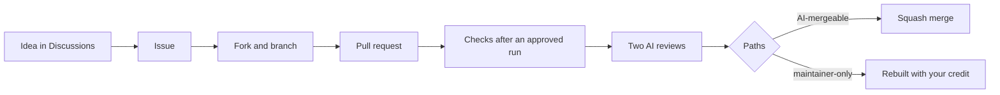

# Contributing

Thank you for helping. Every contribution takes the same path, and AI agents run most of it.



## 1. Start

| You have | Do |
|---|---|
| An idea | Open a [Discussion in Ideas](https://github.com/<owner>/<repo>/discussions/categories/ideas) |
| A bug | Open an issue with the bug form |
| A security problem | [`SECURITY.md`](SECURITY.md); never a public issue |
| Time now | Pick a [`good first issue`](https://github.com/<owner>/<repo>/labels/good%20first%20issue) |

## 2. Run it

```bash
git clone https://github.com/<you>/<repo>
cd <repo>
<install command>
<run command>
```

## 3. Change it

| Rule | Why |
|---|---|
| One change per pull request, with a test for code | Small PRs review fast |
| `<check command>` passes before you push | CI runs the same |
| Sign off each commit: `git commit -s` | The DCO check requires it |
| No secrets, personal data or contact data | The repo is public |
| Say so when an AI tool wrote part of the change | Reviewers read it with that in mind |

## 4. Review and merge

| Your PR changes | What happens |
|---|---|
| Only paths on `ai_mergeable` in `tools/merge_policy.json` | An AI agent squash-merges it once the checks and both reviews pass |
| Any other path: dependencies, build config, CI, hooks, gates, these docs | The orchestrator rebuilds it as its own PR with you as `Co-authored-by`. It links the new PR from yours |

Check your paths first: `python3 -I tools/merge_policy.py --base origin/main`. Agents never approve a PR. A fork's run waits for approval and gets no secrets.
