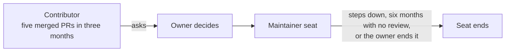

# Maintainers

| Maintainer | GitHub | Since | Can |
|---|---|---|---|
| <Name>, <role> | @<login> | <year> | Everything: merge any PR, promote to production, change these rules |

| AI agents | Rule |
|---|---|
| What they do | Review and merge AI-mergeable PRs (`merge_policy.json`, beside `tools/merge_policy.py`) |
| Maintainers | They are not maintainers |
| Never | Approve a PR, or change the rules they follow |

To become one, see [`GOVERNANCE.md`](GOVERNANCE.md#the-maintainer-seat).

