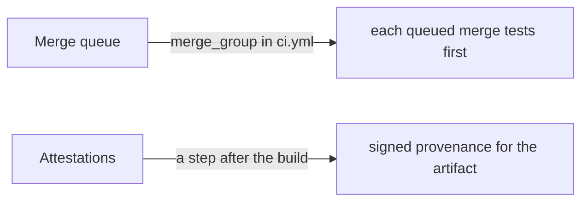

# Options, off by default

Two free GitHub features this starter leaves off, each a row of [setup.json](../setup.json) marked `optional`.

## Merge queue

| Step | Do |
|---|---|
| 1 | Add `merge_group:` under `on:` in `ci.yml`. Under it `changes` finds no base commit, so every job runs |
| 2 | Apply the `rules.merge_queue` row with [apply_setup.mjs](../../tools/apply_setup.mjs) |
| 3 | Merge as before with `gh pr merge`; it stays off `--auto` through `repo.no_auto_merge` |

Each merge adds a CI run, so a quiet repo gains nothing. Free on public org repos (GitHub Docs, read 2026-11-13).

## Attestations

| Step | Do |
|---|---|
| 1 | After the build step, add the [attest action](https://github.com/actions/attest), pinned to a full SHA like every action, with `subject-path` naming the artifact |
| 2 | Give that job `id-token: write`, `attestations: write` and `contents: read` |
| 3 | Read one back: `gh attestation verify <artifact> --repo <owner>/<repo>` |

Only a repo that publishes a built artifact needs this; Git Crafter ships none, so it has no such step. Free on public repos (GitHub Docs, read 2026-11-13).
