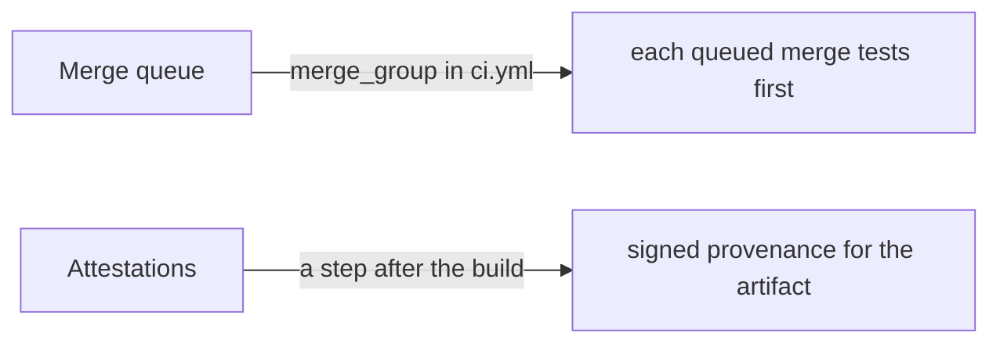

# Options, off by default

Two free GitHub features this starter leaves off, each a row of [setup.json](../setup.json) marked `optional`.

## Merge queue

| Step | Do |
|---|---|
| 1 | Add `merge_group:` under `on:` in `ci.yml`. Under it `changes` finds no base commit, so every job runs |
| 2 | Apply the `rules.merge_queue` row with [apply_setup.mjs](../../tools/apply_setup.mjs) |
| 3 | Add a `merge_group` job that sets the `review` status on `github.sha`. A status sticks to one commit, so the queue's commit lacks the head's `review`. A pull request joins the queue only after its head passed `review` |
| 4 | Merge as before: `gh pr merge N --squash --auto --match-head-commit <sha>` joins the queue once the head's checks pass |

| Fact | Detail |
|---|---|
| CI cost | Each merge adds a CI run, so a quiet repo gains nothing |
| Required checks | The queue waits for each required check on its merge group commit. It removes the pull request at the status check timeout (GitHub Docs, read 2026-11-25) |
| Price | Free on public org repos (GitHub Docs, read 2026-11-13) |

## Attestations

| Step | Do |
|---|---|
| 1 | After the build step, add the [attest action](https://github.com/actions/attest), pinned to a full SHA like every action, with `subject-path` naming the artifact |
| 2 | Give that job `id-token: write`, `attestations: write` and `contents: read` |
| 3 | Read one back: `gh attestation verify <artifact> --repo <owner>/<repo>` |

| Fact | Detail |
|---|---|
| Who needs it | Only a repo that publishes a built artifact |
| Git Crafter | It ships none, so it has no such step |
| Price | Free on public repos (GitHub Docs, read 2026-11-13) |
