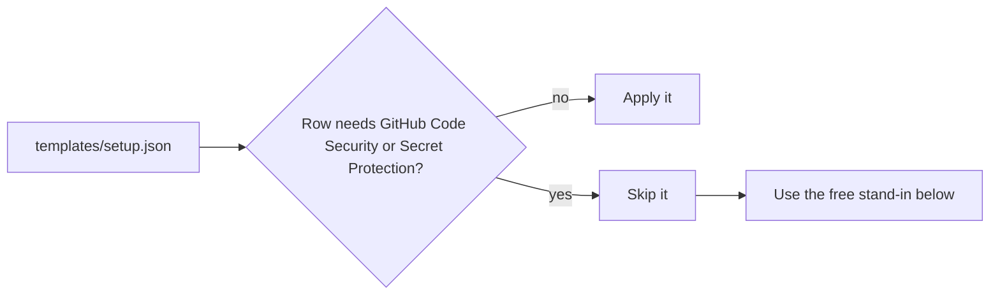

# Personal private repo preset

A private repo on a personal GitHub Pro account cannot turn on GitHub's paid security rows. This page names each one and its free stand-in, so a setup run does not stop at the first refused row.

## Why

| Fact | Source |
|---|---|
| Code Security and Secret Protection need a GitHub Team or Enterprise plan to run on a private repo | GitHub Docs, About GitHub Advanced Security, read 2026-11-25 |
| Dependency graph and Dependabot alerts are in every plan | GitHub Docs, About GitHub Advanced Security, read 2026-11-25 |
| Rulesets work in private repos on GitHub Pro | GitHub Docs, About rulesets, read 2026-11-25 |
| Private vulnerability reporting is for public repositories | GitHub Docs, Configuring private vulnerability reporting, read 2026-11-25 |
| `apply_setup.mjs --apply` reads each row back and skips every row after the first failure | `tools/apply_setup.mjs` |

## Rows to skip, and what stands in

| `setup.json` row | Needs | Free stand-in |
|---|---|---|
| `security.secret_scanning` | Secret Protection | [`secret-scan.yml`](../../.github/workflows/secret-scan.yml): gitleaks over each push and pull request, through [`tools/secret_scan.sh`](../../tools/secret_scan.sh) |
| `security.push_protection` | Secret Protection | The same workflow. It fails the check after the push and does not refuse the push |
| `security.generic_patterns` | Secret Protection | The same workflow |
| `security.validity_checks` | Secret Protection | None. Revoke any key the scan finds |
| `security.delegated_dismissal` | Secret Protection | None. One owner dismisses |
| `security.ai_detection` | Secret Protection | None |
| `security.code_scanning` | Code Security | None shared. Keep the repo's own tests and linter in CI |
| `security.private_reporting` | A public repo | None needed. Nobody outside the repo can see it |

Keep `security.dependabot_alerts` and `security.dependabot_updates`: they are free. Dependency review needs Code Security and has no row.

## Apply

| Step | Do |
|---|---|
| 1 | Copy `secret-scan.yml` and `tools/secret_scan.sh` into the repo. Require the check in the default branch ruleset |
| 2 | Run `apply_setup.mjs --repo <owner>/<repo> --apply --only` with every row id except the eight above |
| 3 | Run it again with `--check`. A row left to a stand-in reads as a row to skip, not a failure to fix |
