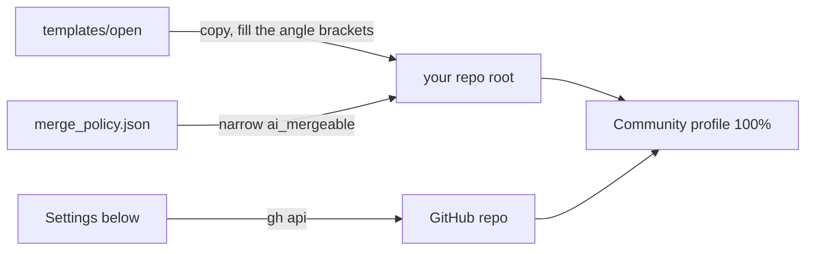

# Open-repo starter

Files and settings that open a Git Crafter repo to outside contributors, with AI agents reviewing and merging ([outside PRs](../../skills/merging/outside.md)).

## Copy

| File | To | Set |
|---|---|---|
| `CONTRIBUTING.md`, `GOVERNANCE.md`, `MAINTAINERS.md`, `SECURITY.md` | the repo root | `<owner>/<repo>`, the run commands, the maintainer row |
| `LICENSE`, such as MIT or Apache-2.0 | the repo root | the year and holder |
| Git Crafter's [`CODE_OF_CONDUCT.md`](../../CODE_OF_CONDUCT.md), [`SUPPORT.md`](../../SUPPORT.md) | the repo root | the project name |
| [`templates/agents/`](../agents/) | the repo root | as that folder says |
| `.github/PULL_REQUEST_TEMPLATE.md`, `.github/ISSUE_TEMPLATE/`, `.github/DISCUSSION_TEMPLATE/`, `.github/CODEOWNERS`, `.github/dco.yml`, `.github/release.yml`, `.github/FUNDING.yml` | the same paths | the owner login in `CODEOWNERS`; your `FUNDING.yml` destinations |
| `labels.json` | the label step reads it | nothing |
| [`merge_policy.json`](merge_policy.json) and [`tools/merge_policy.py`](../../tools/merge_policy.py) | `tools/`, side by side | `ai_mergeable` to your content paths |
| [`wiki/`](wiki/), [`wiki.yml`](../ci/wiki.yml) | `wiki/`, `.github/workflows/` | `<owner>/<repo>` |

## Settings

Each is one call or a web UI step (GitHub Docs and the gh manual, read 2026-11-12 and 2026-11-13). Read each back after.

| Setting | Call |
|---|---|
| Fork runs wait for approval | `gh api -X PUT repos/<owner>/<repo>/actions/permissions/fork-pr-contributor-approval -f approval_policy=all_external_contributors` |
| Private vulnerability reporting | `gh api -X PUT repos/<owner>/<repo>/private-vulnerability-reporting` |
| Secret scanning and push protection | `gh api -X PATCH repos/<owner>/<repo> --input security.json`, both `status` fields `enabled` |
| Discussions on | GraphQL `updateRepository(input: {repositoryId, hasDiscussionsEnabled: true})`; create the Ideas, Q&A and Show and tell categories in the web UI, the one step no API covers |
| Squash only, required checks | `gh api -X POST repos/<owner>/<repo>/rulesets`: a `pull_request` rule with `allowed_merge_methods: ["squash"]`, and `required_status_checks` naming your CI and DCO |
| Labels | `gh label create <name> --color <hex> --description <text>` per `labels.json` entry |
| Wiki on | `gh repo edit <owner>/<repo> --enable-wiki` |
| Wiki editing by collaborators only; the first page | the default, keep it; web UI only |
| Push limit, 5 refs a push (Docs' suggestion) | web UI only; public preview |
| Sponsor button | GraphQL `updateRepository(input: {repositoryId, hasSponsorshipsEnabled: true})`; reads `FUNDING.yml` |
| Immutable releases | `gh api -X PUT repos/<owner>/<repo>/immutable-releases` |
| A Release per tag | `gh release create <tag> --verify-tag --generate-notes` |
| Topics, homepage | `gh repo edit <owner>/<repo> --add-topic <topic> --homepage <url>` |
| Social preview image | web UI only; under 1 MB, 1280 by 640 |
| Template flag, starter repos only | `gh repo edit <owner>/<repo> --template` |

## Options, off by default

| Option | For | Turn on |
|---|---|---|
| Merge queue | a busy branch, with several human maintainers | rule "Require merge queue"; CI runs `on: merge_group`; `gh pr merge` then turns on auto-merge while checks run |
| Artifact attestations | a repo that publishes a built artifact | `actions/attest`, with `id-token: write` and `attestations: write` |

## Check

| Metric | Goal | Read |
|---|---|---|
| Community profile `health_percentage` | 100 | `gh api repos/<owner>/<repo>/community/profile -q .health_percentage` |
| Merge policy self-test | PASS | `python3 -I tools/merge_policy.py --self-test` |
| OpenSSF Scorecard, from [`scorecard.yml`](../ci/scorecard.yml) | 8 or more, a goal | `curl -s https://api.scorecard.dev/projects/github.com/<owner>/<repo> \| jq .score` |
