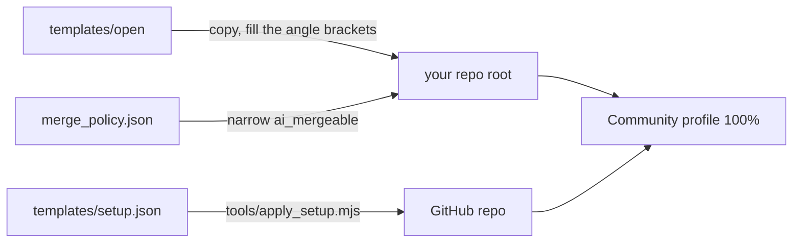

# Open-repo starter

Files and settings that open a Git Crafter repo to outside contributors, with AI agents reviewing and merging ([outside PRs](../../skills/merging/outside.md)).

## Copy

| File | To | Set |
|---|---|---|
| `CONTRIBUTING.md`, `GOVERNANCE.md`, `MAINTAINERS.md`, `SECURITY.md` | the repo root | `<owner>/<repo>`, the run commands, the maintainer row |
| `LICENSE`, such as MIT or Apache-2.0 | the repo root | the year and holder |
| Git Crafter's [`CODE_OF_CONDUCT.md`](../../CODE_OF_CONDUCT.md), [`SUPPORT.md`](../../SUPPORT.md) | the repo root | the project name |
| [`templates/agents/`](../agents/) | the repo root | as that folder says |
| `.github/PULL_REQUEST_TEMPLATE.md`, `.github/ISSUE_TEMPLATE/`, `.github/DISCUSSION_TEMPLATE/`, `.github/CODEOWNERS`, `.github/dco.yml`, `.github/release.yml`, `.github/FUNDING.yml` | the same paths | the owner login in `CODEOWNERS`; your `FUNDING.yml` destinations |
| `labels.json` | the label step reads it | nothing |
| [`merge_policy.json`](merge_policy.json) and [`tools/merge_policy.py`](../../tools/merge_policy.py) | `tools/`, side by side | `ai_mergeable` to your content paths |
| [`wiki/`](wiki/), [`wiki.yml`](../ci/wiki.yml) | `wiki/`, `.github/workflows/` | `<owner>/<repo>` |

## Settings

[`setup.json`](../setup.json) lists each repo switch these files assume, one row each; [`apply_setup.mjs`](../../tools/apply_setup.mjs) sets them with `gh api` (GitHub Docs and the gh manual, read 2026-11-12 and 2026-11-13). Run it from a Git Crafter clone, signed in to `gh` as the repo admin.

| Step | Command |
|---|---|
| Show what would change | `node tools/apply_setup.mjs --repo <owner>/<repo> --values values.json` |
| Set each change, then read it back | the same, with `--apply` |
| Exit 1 if a required row differs | the same, with `--check` |

`values.json` holds your `topics`, `homepage`, `description` and `optional_on`, the optional rows to turn on ([Git Crafter's](../../config/setup-values.json)). A `by hand` row names its web UI step. The list leaves out three:

| Setting | Call |
|---|---|
| Required checks | a `required_status_checks` rule naming your CI and DCO, in the default branch ruleset |
| Labels | `gh label create <name> --color <hex> --description <text>` per `labels.json` entry |
| A Release per tag | `gh release create <tag> --verify-tag --generate-notes` |

## Options, off by default

Name a row in `optional_on` to turn it on.

| Option | For | Row, and what else it needs |
|---|---|---|
| Merge queue | a busy branch, with several human maintainers | `rules.merge_queue`; CI runs `on: merge_group`; `gh pr merge` then turns on auto-merge while checks run |
| Artifact attestations | a repo that publishes a built artifact | `manual.artifact_attestations`: `actions/attest`, with `id-token: write` and `attestations: write` |

## Check

| Metric | Goal | Read |
|---|---|---|
| Community profile `health_percentage` | 100 | `gh api repos/<owner>/<repo>/community/profile -q .health_percentage` |
| Merge policy self-test | PASS | `python3 -I tools/merge_policy.py --self-test` |
| OpenSSF Scorecard, from [`scorecard.yml`](../ci/scorecard.yml) | 8 or more, a goal | `curl -s https://api.scorecard.dev/projects/github.com/<owner>/<repo> \| jq .score` |
