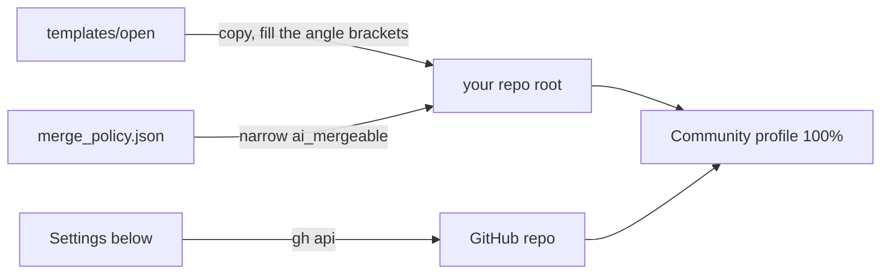

# Open-repo starter

Files and settings that open a Git Crafter repo to outside contributors, with AI agents reviewing and merging ([outside PRs](../../skills/merging/outside.md)).

## Copy

| File | To | Set |
|---|---|---|
| `CONTRIBUTING.md`, `GOVERNANCE.md`, `MAINTAINERS.md`, `SECURITY.md` | the repo root | `<owner>/<repo>`, the run commands, the maintainer row |
| A `LICENSE` file, such as MIT or Apache-2.0 | the repo root | the year and holder |
| Git Crafter's [`CODE_OF_CONDUCT.md`](../../CODE_OF_CONDUCT.md), [`SUPPORT.md`](../../SUPPORT.md) | the repo root | the project name |
| [`templates/agents/`](../agents/) | the repo root | as that folder says |
| `.github/PULL_REQUEST_TEMPLATE.md`, `.github/ISSUE_TEMPLATE/`, `.github/DISCUSSION_TEMPLATE/`, `.github/CODEOWNERS`, `.github/dco.yml` | the same paths | the owner login in `CODEOWNERS` |
| `labels.json` | read by the label step below | nothing |
| [`merge_policy.json`](merge_policy.json) and [`tools/merge_policy.py`](../../tools/merge_policy.py) | `tools/`, side by side | `ai_mergeable` to your content paths |
| [`wiki/Home.md`](wiki/Home.md) and [`templates/ci/wiki.yml`](../ci/wiki.yml) | `wiki/Home.md`, `.github/workflows/wiki.yml` | `<project>`, `<owner>/<repo>`; then the two wiki steps below |

## Settings

Each is one API call (GitHub Docs, read 2026-11-12). Read each back after.

| Setting | Call |
|---|---|
| Fork runs wait for approval | `gh api -X PUT repos/<owner>/<repo>/actions/permissions/fork-pr-contributor-approval -f approval_policy=all_external_contributors` |
| Private vulnerability reporting | `gh api -X PUT repos/<owner>/<repo>/private-vulnerability-reporting` |
| Secret scanning and push protection | `gh api -X PATCH repos/<owner>/<repo> --input security.json`, both `status` fields `enabled` |
| Discussions on | GraphQL `updateRepository(input: {repositoryId, hasDiscussionsEnabled: true})`; create the Ideas, Q&A and Show and tell categories in the web UI, the one step no API covers |
| Squash only, required checks | `gh api -X POST repos/<owner>/<repo>/rulesets`: a `pull_request` rule with `allowed_merge_methods: ["squash"]`, and `required_status_checks` naming your CI and DCO |
| Labels | `gh label create <name> --color <hex> --description <text>` per `labels.json` entry |
| Wiki editing limited to push access | Web UI only: Settings, Features, Wikis on, with "Restrict editing to collaborators only" ticked (GitHub Docs, [Changing access permissions for wikis](https://docs.github.com/en/communities/documenting-your-project-with-wikis/changing-access-permissions-for-wikis), read 2026-11-13) |
| Wiki's git repository exists | Web UI only: create the first page once; its git repository can be cloned after that (GitHub Docs, [Adding or editing wiki pages](https://docs.github.com/en/communities/documenting-your-project-with-wikis/adding-or-editing-wiki-pages), read 2026-11-13). Then `wiki.yml` publishes `wiki/` on each merge, so pages change only by pull request |

## Check

| Metric | Goal | Read |
|---|---|---|
| Community profile `health_percentage` | 100 | `gh api repos/<owner>/<repo>/community/profile -q .health_percentage` |
| Merge policy self-test | PASS | `python3 -I tools/merge_policy.py --self-test` |
| OpenSSF Scorecard, from [`scorecard.yml`](../ci/scorecard.yml) | 8 or more, a goal | `curl -s https://api.scorecard.dev/projects/github.com/<owner>/<repo> \| jq .score` |
