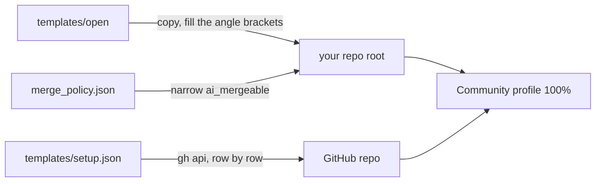

# Open-repo starter

Files and settings that open a repo to outside contributors, with AI agents reviewing and merging ([outside PRs](../../skills/merging/outside.md)).

## Copy

| File | To | Set |
|---|---|---|
| `CONTRIBUTING.md`, `GOVERNANCE.md`, `MAINTAINERS.md`, `SECURITY.md`, `SUPPORT.md` | the repo root | the [placeholders](#placeholders) |
| `LICENSE` | the repo root | your license, year and holder |
| Git Crafter's [`CODE_OF_CONDUCT.md`](../../CODE_OF_CONDUCT.md) | the repo root | the project name |
| [`templates/agents/`](../agents/) | the repo root | as that folder says |
| `.github/PULL_REQUEST_TEMPLATE.md`, `.github/ISSUE_TEMPLATE/`, `.github/DISCUSSION_TEMPLATE/`, `.github/CODEOWNERS`, `.github/dco.yml`, `.github/release.yml`, `.github/FUNDING.yml` | the same paths | your `FUNDING.yml` destinations |
| `labels.json` | anywhere. The Labels row below reads it | nothing |
| [`merge_policy.json`](merge_policy.json) and [`tools/merge_policy.py`](../../tools/merge_policy.py) | `tools/`, side by side | `ai_mergeable` to your content paths |
| [`wiki/`](wiki/), [`wiki.yml`](../ci/wiki.yml) | `wiki/`, `.github/workflows/` | `<owner>/<repo>` |
| [`PERSONAL-PRIVATE.md`](PERSONAL-PRIVATE.md) | read, not copied | the 8 rows a private repo on a personal Pro account skips, and each free stand-in |

## Placeholders

| Placeholder | In | Set it to |
|---|---|---|
| `<owner>`, `<repo>` | every file | the GitHub owner and repo names |
| `<Owner>` | `GOVERNANCE.md` | the owner |
| `<project>` | `wiki/Home.md` | the project's name |
| `<Name>`, `<role>`, `<year>` | `MAINTAINERS.md` | a maintainer's name, role and first year |
| `@<login>` | `MAINTAINERS.md`, `CODEOWNERS` | a GitHub login: the maintainer's, the owner's |
| `<contact address>`, `<deploy doc>` | `SECURITY.md` | an address for reporters off GitHub; the doc on staging and rollback |
| `<you>` | `CONTRIBUTING.md` | your GitHub login |
| `<install command>`, `<run command>`, `<check command>` | `CONTRIBUTING.md` | your commands |

## Settings

[`setup.json`](../setup.json) holds one row per repo switch these files assume (GitHub Docs and the gh manual, read 2026-11-12 and 2026-11-13). Apply each as the repo admin in `gh`.

| Row | Do |
|---|---|
| From a Git Crafter checkout, `node tools/apply_setup.mjs --repo <owner>/<repo>` | A dry run. `--apply` sets each row it would change, then reads it back. `--check` exits 1 on drift |
| `method`, `path`, `body` | `gh api -X <method> <path> --input body.json`, the row's `body` in `body.json`. No `body`, no `--input` |
| `{owner}`, `{repo}`, `{topics}`, `{homepage}`, `{description}` | Your values. `{node_id}` is `gh api repos/<owner>/<repo> -q .node_id` |
| `api: false`, `when: no_org_ruleset` | Its `reason` names the web UI step. Skip a `no_org_ruleset` row if your org sets that ruleset |

| Not in the list | Call |
|---|---|
| Required checks | a `required_status_checks` rule naming CI and DCO in the default branch ruleset |
| Labels | `gh label create <name> --color <hex> --description <text>` per `labels.json` entry |
| A Release per tag | `gh release create <tag> --verify-tag --generate-notes` |

## Options, off by default

| Option (`optional: true`) | For | Row and needs |
|---|---|---|
| Merge queue | a busy branch | `rules.merge_queue`. CI runs `on: merge_group` ([how](OPTIONS.md#merge-queue)). `gh pr merge` after checks pass: `repo.no_auto_merge` keeps auto-merge off |
| Artifact attestations | a repo that publishes an artifact | `manual.artifact_attestations`: [actions/attest](https://github.com/actions/attest), with `id-token: write` and `attestations: write` ([step](OPTIONS.md#attestations)) |

## Check

| Metric | Goal | Read |
|---|---|---|
| Community profile `health_percentage` | 100 | `gh api repos/<owner>/<repo>/community/profile -q .health_percentage` |
| Merge policy self-test | PASS | `python3 -I tools/merge_policy.py --self-test` |
| OpenSSF Scorecard, from [`scorecard.yml`](../ci/scorecard.yml) | Advisory. Bot and AI reviews do not count toward Code-Review. Maintained needs a repo over 90 days old (ossf/scorecard docs/checks.md, read 2026-11-14) | `curl -s https://api.scorecard.dev/projects/github.com/<owner>/<repo> \| jq .score` |
