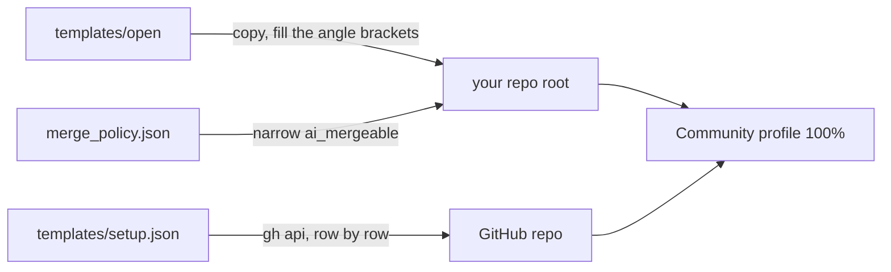

# Open-repo starter

Files and settings that open a Git Crafter repo to outside contributors, with AI agents reviewing and merging ([outside PRs](../../skills/merging/outside.md)).

## Copy

| File | To | Set |
|---|---|---|
| `CONTRIBUTING.md`, `GOVERNANCE.md`, `MAINTAINERS.md`, `SECURITY.md` | the repo root | `<owner>/<repo>`, the run commands, the maintainer row |
| `LICENSE`, such as MIT or Apache-2.0 | the repo root | the year and holder |
| Git Crafter's [`CODE_OF_CONDUCT.md`](../../CODE_OF_CONDUCT.md), [`SUPPORT.md`](../../SUPPORT.md) | the repo root | the project name |
| [`templates/agents/`](../agents/) | the repo root | as that folder says |
| `.github/PULL_REQUEST_TEMPLATE.md`, `.github/ISSUE_TEMPLATE/`, `.github/DISCUSSION_TEMPLATE/`, `.github/CODEOWNERS`, `.github/dco.yml`, `.github/release.yml`, `.github/FUNDING.yml` | the same paths | the owner login in `CODEOWNERS`; your `FUNDING.yml` destinations |
| `labels.json` | the label step reads it | nothing |
| [`merge_policy.json`](merge_policy.json) and [`tools/merge_policy.py`](../../tools/merge_policy.py) | `tools/`, side by side | `ai_mergeable` to your content paths |
| [`wiki/`](wiki/), [`wiki.yml`](../ci/wiki.yml) | `wiki/`, `.github/workflows/` | `<owner>/<repo>` |

## Settings

[`setup.json`](../setup.json) lists each repo switch these files assume, one row each (GitHub Docs and the gh manual, read 2026-11-12 and 2026-11-13). Apply each row signed in to `gh` as the repo admin.

| Row | Do |
|---|---|
| `method`, `path`, `body` | `gh api -X <method> <path> --input body.json`, the row's `body` in `body.json`; no `body`, no `--input` |
| `{owner}`, `{repo}`, `{topics}`, `{homepage}`, `{description}` | your values; `{node_id}` is `gh api repos/<owner>/<repo> -q .node_id` |
| `check` | `gh api` its `get`, or `path`: `field` should equal `value` |
| `api: false` | its `reason` names the web UI step |
| `when: no_org_ruleset` | skip it if your org sets a ruleset of that target |

The list leaves out three:

| Setting | Call |
|---|---|
| Required checks | a `required_status_checks` rule naming your CI and DCO, in the default branch ruleset |
| Labels | `gh label create <name> --color <hex> --description <text>` per `labels.json` entry |
| A Release per tag | `gh release create <tag> --verify-tag --generate-notes` |

## Options, off by default

Each is an `optional: true` row: apply it only if your repo needs it.

| Option | For | Row, and what else it needs |
|---|---|---|
| Merge queue | a busy branch, with several human maintainers | `rules.merge_queue`; CI runs `on: merge_group`; `gh pr merge` then turns on auto-merge while checks run |
| Artifact attestations | a repo that publishes a built artifact | `manual.artifact_attestations`: `actions/attest`, with `id-token: write` and `attestations: write` |

## Check

| Metric | Goal | Read |
|---|---|---|
| Community profile `health_percentage` | 100 | `gh api repos/<owner>/<repo>/community/profile -q .health_percentage` |
| Merge policy self-test | PASS | `python3 -I tools/merge_policy.py --self-test` |
| OpenSSF Scorecard, from [`scorecard.yml`](../ci/scorecard.yml) | 8 or more, a goal | `curl -s https://api.scorecard.dev/projects/github.com/<owner>/<repo> \| jq .score` |
