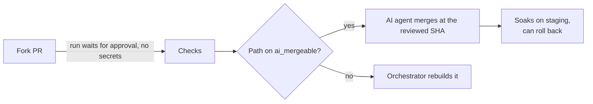

# Security

## Report a vulnerability

| Way | Use it for |
|---|---|
| [Report a vulnerability](https://github.com/<owner>/<repo>/security/advisories/new) (GitHub private reporting) | Anything in this repo |
| <contact address> | When you cannot use GitHub |

Please do not open a public issue. A person replies.

## How outside code is kept safe

| Control | Where |
|---|---|
| Every fork run waits for approval and gets no secrets | Repo settings; `pull_request`, never `pull_request_target` with a fork checkout |
| AI agents merge only allowlisted paths, at the reviewed head SHA, and never approve | `merge_policy.json`, beside `tools/merge_policy.py` |
| Build, CI, dependency and gate changes are rebuilt by the orchestrator, never merged as sent | [`CONTRIBUTING.md`](CONTRIBUTING.md) |
| Secret scanning and push protection on | Repo settings |
| A merged change soaks on staging and can be rolled back | <deploy doc> |

