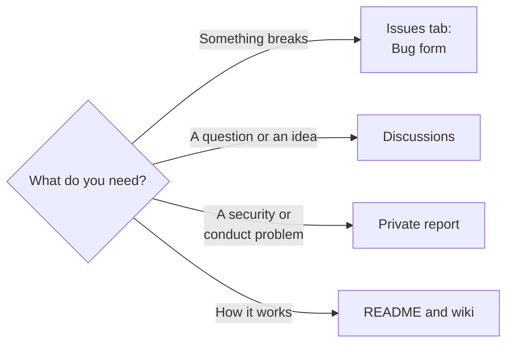

# Support

| Need | Where |
|---|---|
| Report a bug | [Issues](https://github.com/<owner>/<repo>/issues/new/choose), the **Bug** form |
| Ask a question | [Discussions, Q&A](https://github.com/<owner>/<repo>/discussions/categories/q-a) |
| Propose an idea | [Discussions, Ideas](https://github.com/<owner>/<repo>/discussions/categories/ideas) |
| Report a security problem | [SECURITY.md](SECURITY.md). Never a public issue |
| Report conduct | [CODE_OF_CONDUCT.md](https://github.com/<owner>/<repo>/blob/main/CODE_OF_CONDUCT.md) |
| Contribute a change | [CONTRIBUTING.md](CONTRIBUTING.md) |
| Learn how it works | [README.md](README.md) and the [wiki](https://github.com/<owner>/<repo>/wiki) |
