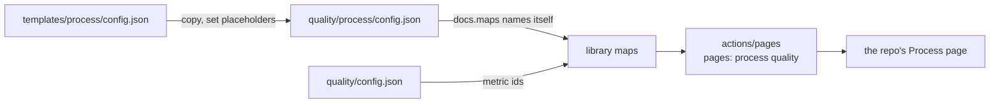

# Process starter

[config.json](config.json) is the Process page config for one repo, and its maps file too. Copy it to `<repo>/quality/process/config.json`, replace the three placeholders, and keep the maps you use.

## Placeholders

| Placeholder | Where | Set it to |
|---|---|---|
| `my-repo` | `repos` | your repo's name, with no owner |
| `OWNER`, `my-repo` | `repo_url` | your GitHub owner and repo name |
| `my-repo` | `heading` | the page title |

## Keys

| Key | Set it to |
|---|---|
| `repos` | the repo the page reads; the first is its own |
| `repo_url` | `https://github.com/<owner>/<repo>/blob/main`, where each rule link points |
| `docs` | `maps` names this file: it is the maps file too. Git Crafter's goals and process docs fill the rest |
| `maps` | `{ "use": "<id>" }` per map ([pages/maps](../../pages/maps/README.md)) |
| `data` | the file the collector writes and the build reads |
| `history` | a folder of daily files, or `null` for none |
| `out` | the folder the pages are built into |
| `pages` | the Process page's file name, beside the Quality page's `index.html` |
| `tabs` | the Process tabs: `build` (titled "Maps"), `ci`, `testing` |
| `quality_config` | the Quality config whose metric ids the maps use; `null` reads the repo's `quality/config.json` |
| `heading` | the title on every page |
| `collector` | the name the footer gives the data's writer |
| `nav` | the links on every page: the Quality page, then this one |

## Maps

A token a map needs is one the Quality page needs ([each token](../quality/README.md#each-tab-and-what-it-needs)). Without it a step reads not measured, never 0.

| Map | In the starter | Needs |
|---|:-:|---|
| `delivery` | ✓ | none |
| `deploy` | ✓ | `wrangler-login` |
| `adopt` | ✓ | `github-admin` |
| `measure` | ✓ | none |
| `code` | ✓ | none |
| `triage` | ✓ | `project-scope` |
| `secure` | ✓ | `github-admin` |
| `board` | ✗ | `project-scope` |
| `document` | ✗ | none |
| `contribute` | ✗ | `github-admin`, `wrangler-login` |
| `release` | ✗ | `github-admin`, `gh` |
| `score` | ✗ | none |

A step whose metric sits on a tab your Quality config drops fails the build: drop it with `"steps": { "<id>": { "drop": true } }`. Every key: [actions/pages/action.yml](../../actions/pages/action.yml).
