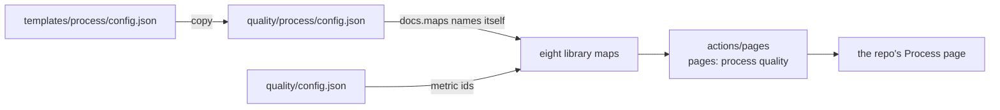

# Process starter

[config.json](config.json) is the Process page config for one repo, and its maps file too. Copy it to `<repo>/quality/process/config.json`, set `repos`, `repo_url` and `heading` to your repo, and keep the maps you use.

| Key | Set it to |
| --- | --- |
| `repos` | your repo's name, the one the page reads |
| `repo_url` | `https://github.com/<owner>/<repo>/blob/main`, where each rule link points |
| `maps` | `{ "use": "<id>" }` per map: delivery, deploy, adopt, measure, code, triage, secure ([pages/maps](../../pages/maps/README.md)) |
| `tabs` | the Process tabs: build, ci, testing, claude, tokens |

A map step whose metric sits on a tab your Quality config drops fails the build: drop that step with `"steps": { "<id>": { "drop": true } }`. Every key: [actions/pages/action.yml](../../actions/pages/action.yml).
