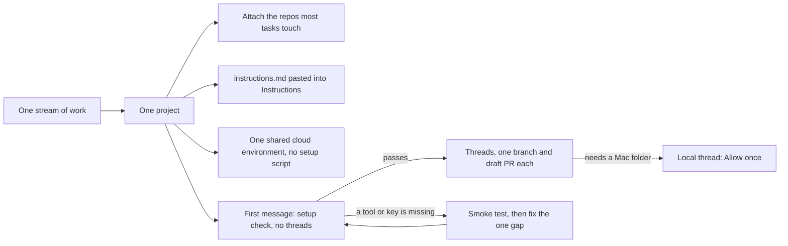

# Claude Projects setup

A Claude Code Project is one coordinating conversation plus the cloud threads it starts. This template sets one up for an org's repos.



| Decision | Rule | Why |
|---|---|---|
| Projects | One project per stream of work | A project suits a goal that outlasts one session and keeps producing tasks |
| Repos | Attach the 1 or 2 repos most tasks touch. Name the rest in the instructions | Every cloud thread starts with the attached repos and each one's `CLAUDE.md` |
| Environment | One cloud environment shared by every project | One place to set network access and keys |
| Setup script | None, until a smoke test proves a gap | The image already has `uv`, `pip`, `ruff`, `pytest`, `npm`, `pnpm`, `yarn` and `bun` |
| Keys | Network secrets only, never environment variables | The agent proxy adds a secret to a request outside the VM. Anyone who uses the environment can read a variable |
| First message | A setup check that starts no threads | A gap shows up before any work depends on it |
| Mac folders | Only through a local thread's **Allow once** card | The card names the folder and asks before Claude touches it |
| Dot-named repo | Work on it in a thread of its own | A thread with a dot-named repo skips every repo's skills, agents and commands |

## Set up a project

| Step | Do | Check |
|---|---|---|
| 1 | Create the project and attach the 1 or 2 repos most tasks touch | Each repo has the Claude GitHub App installed |
| 2 | Copy [instructions.md](instructions.md) into the project's instructions and fill every `<...>` cell | No cell is left blank. A blank one reads as "ask" |
| 3 | Set the environment to the shared one in Project settings | Its setup script is empty |
| 4 | Add each key as a network secret on that environment, with its host | No key value sits in a variable, a file or a message |
| 5 | Send the setup check below as the first message | The reply lists what passed and what is missing, and no thread starts |

## The setup check

Paste this as the project's first message:

```text
Setup check only. Start no threads and change nothing.
1. List the attached repos and say whether each CLAUDE.md or AGENTS.md was read.
2. Say whether GitHub push access works for each attached repo.
3. Name the connectors you can reach.
4. Name the environment and say whether it has a setup script.
5. Name every key you expect, by name only, and say whether each is a network secret.
6. Report pass or fail per line, and name the tool or key that is missing.
```

## Smoke test before any setup script

A setup script runs on every new session, so add one only for a gap a test has shown. Run the test in one thread and change nothing.

| Check | How |
|---|---|
| Tool versions | Print the versions of `node`, `npm`, `python3` and `uv` |
| Fastest repo check | Run the one check the repo's `CLAUDE.md` or `AGENTS.md` names |
| Variables | Print the names of the environment variables, never the values |
| Result | Report pass or fail, and name each missing tool |

If a tool is missing, put the install in the setup script. If a key is missing, add a network secret. `bun` has known proxy issues when it fetches packages (cloud-environments docs), so run installs through `npm` or `pnpm`.

## Local folders

A cloud thread cannot see a folder on a Mac. When a task needs one, ask for a local thread. Claude answers with an **Allow Claude to work in a folder on your computer** card. Pick the folder, then click **Allow once**. Do not give a cloud thread a path to a Mac folder.

## Sources

| Fact | Source | Read |
|---|---|---|
| A project is one conversation plus threads. A thread starts with the repos, instructions and each repo's `CLAUDE.md` | [code.claude.com/docs/en/claude-projects](https://code.claude.com/docs/en/claude-projects) | 2026-11-24 |
| A thread whose repo name starts with a dot skips repo skills, agents and commands | [code.claude.com/docs/en/claude-projects](https://code.claude.com/docs/en/claude-projects) | 2026-11-24 |
| A local thread asks first with an **Allow once** card | [code.claude.com/docs/en/claude-projects](https://code.claude.com/docs/en/claude-projects) | 2026-11-24 |
| The default environment has no setup script and lists its pre-installed tools | [code.claude.com/docs/en/cloud-environments](https://code.claude.com/docs/en/cloud-environments) | 2026-11-24 |
| Network secrets stay outside the VM, and anyone who uses the environment can read a variable | [code.claude.com/docs/en/cloud-environments](https://code.claude.com/docs/en/cloud-environments) | 2026-11-24 |
| A setup script runs when a new cloud session starts, before Claude Code launches | [code.claude.com/docs/en/cloud-environments](https://code.claude.com/docs/en/cloud-environments) | 2026-11-24 |
