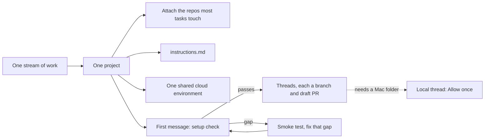

# Claude Projects setup

A Claude Code Project is one coordinating conversation plus the cloud threads it starts. This template sets one up for an org's repos.



| Decision | Rule | Why |
|---|---|---|
| Projects | One per stream of work | A project suits a goal that outlasts one session |
| Repos | Attach the 1 or 2 repos most tasks touch. Name the rest in [instructions.md](instructions.md) | Each thread starts with the attached repos and their `CLAUDE.md` |
| Environment | One cloud environment for every project | One place for network access and keys |
| Setup script | None until a smoke test proves a gap | The image has `uv`, `pip`, `ruff`, `pytest`, `npm`, `pnpm`, `yarn` and `bun` |
| Keys | Network secrets, never variables | The agent proxy adds a secret outside the VM. Anyone using the environment reads a variable |
| First message | A setup check that starts no threads | A gap shows before work depends on it |
| Mac folders | Only a local thread's **Allow once** card | The card names the folder and asks first |
| Dot-named repo | Work on it in a local thread (Remote Control) | A cloud thread with a dot-named repo skips every repo's skills |
| Tracking | The Track row in [instructions.md](instructions.md). Bugs are issues and features are draft cards, each filed over REST | A cloud thread's proxy blocks GraphQL. A project thread runs no repo hooks |

## Steps

| Step | Do |
|---|---|
| 1 | Create the project. Attach the repos, each with the Claude GitHub App installed |
| 2 | Paste [instructions.md](instructions.md) into Instructions and fill each `<...>` cell |
| 3 | Set the shared environment in Project settings, with an empty setup script |
| 4 | Add each key as a network secret with its host |
| 5 | Send the setup check below as the first message |

```text
Setup check only. Start no threads and change nothing.
1. For each attached repo: was CLAUDE.md or AGENTS.md read, and does push access work?
2. Name the connectors and the environment, and say whether it has a setup script.
3. Name each expected key, by name only, and say whether it is a network secret.
4. Report pass or fail per line, and name any missing tool or key.
```

## Smoke test

Add a setup script only for a test-proven gap: it rebuilds on script or host changes and after about 7 days. Change nothing and report pass or fail.

| Check | How |
|---|---|
| Versions | Print `node`, `npm`, `python3` and `uv` versions |
| Repo check | Run the fastest check the repo's `CLAUDE.md` names |
| Variables | Print names only, never values. `AWS_*`, `CLOUDSDK_*`, `GH_TOKEN` and `GITHUB_TOKEN` are the sandbox's own |

`bun` has known proxy issues fetching packages, so install through `npm` or `pnpm`.

## Sources

Read 2026-11-24: [claude-projects](https://code.claude.com/docs/en/claude-projects) for threads, instructions, dot-named repos and **Allow once**. [cloud-environments](https://code.claude.com/docs/en/cloud-environments) for the default environment, pre-installed tools, network secrets and setup scripts. [REST draft Project items](https://docs.github.com/en/rest/projects/drafts) for the cards a thread files.
