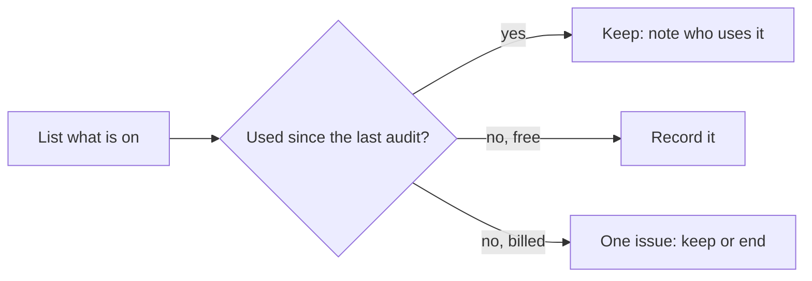

# Active and unused audit

Part of the [Projects setup](README.md). The [setup check](check-card.md) reads what is set. This audit lists what is switched on and never used, so no seat, credit or lane sits idle. It reads and records. It switches nothing off.

## What to list

| Kind | Active means | Used means | Read from |
|---|---|---|---|
| Plan or seat | Assigned and billed or included | A session ran under it | The vendor's usage page |
| API credit | Granted, not expired | A job drew on it | The console's credit page |
| Cloud environment | Attached to the project | A thread ran in it | Project settings, Usage (token use by thread) |
| Connector or plugin | Connected | A thread called a tool | A thread's tool list |
| Paid repo feature | A licence is assigned | The feature produced a finding or a run | The repo's settings page |
| Free-tier lane | Signed up | A job ran on it | The lane's dashboard |

## Reads that need a Mac

A cloud thread cannot read these. A local thread (Remote Control) reads each and changes none.

| Read | Where it sits |
|---|---|
| Folders Claude may use without asking | The desktop app, per machine |
| Permission mode and deny rules | `~/.claude/settings.json`, and a project's `.claude/settings.json` |
| Installed plugins and their source | Claude Code's plugin list on that machine |
| Each clone's branch and state | The disk: `git status` |
| A web settings page the cloud tool refuses | Claude in Chrome, from a local session |

## Result

One row per item: item, active, used, read (UTC), source, then keep, record or issue. A row not read is marked "not read", never a guess.

## Sources

Read 2026-11-25: [claude-projects](https://code.claude.com/docs/en/claude-projects) for Project settings and its Usage tab. [settings](https://code.claude.com/docs/en/settings) for the user and project settings files.
