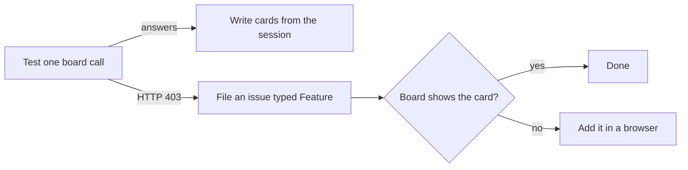

# Board access from a cloud session

A Claude Code cloud session reaches only the repositories attached to it. This guide says what that means for an org's project board, how to test it, and what to do when GitHub or the session refuses.

## What cloud sessions cannot do

Read 2026-11-26 in a cloud session bound to its repos. Each call below was refused with HTTP 403.

| Call | What the session said |
|---|---|
| `gh api orgs/<owner>/projectsV2/<n>` and its `/items` | The path is not available: sessions are bound to their configured repositories |
| GraphQL, which Projects v2 also offers | GraphQL is not available from Claude Code sessions |
| `PATCH repos/<owner>/<repo>` for the description, `PUT .../topics` | Repository settings writes are not permitted through this proxy |

The refusal names the session's binding, not a missing GitHub App permission. Granting the Claude GitHub App more rights was not shown to help. Changing the app's installation asks for a passkey or code, which only a person gives, so a session cannot test it.

## Test it

Run one read first, so a failure costs nothing: `gh api orgs/<owner>/projectsV2/<n> --jq .title`. A title means the session can write cards, and `projectsV2/<n>/drafts` files one. HTTP 403 means use the steps below.

## What works

| Need | Do |
|---|---|
| A feature or idea | File an issue typed Feature with the `enhancement` label and one area label: `gh api repos/<owner>/<repo>/issues -f type=Feature -f title=<t> -f 'labels[]=enhancement' -F body=@body.md` |
| Sub-tasks of a card | `POST repos/<owner>/<repo>/issues/<parent>/sub_issues` with `-F sub_issue_id=<id>`. The board shows them under the parent |
| A card the board did not add | Open the board in a browser, then **Add item**, the repo, and tick the issues. Closed issues land as Done, open ones as Todo |
| A repo setting | Change it in the repo's own page in a browser, after the claim the org requires |

## Check, never assume

Auto-add can miss. On 2026-11-26 an org board carded some new issues typed Feature and left out others of the same type. After filing, read the board. List each issue that is not there in the PR's `To card` table, and say who adds it.

## Why it is this way

| Reason | Source |
|---|---|
| A session is bound to its repos | The 403 text above, seen 2026-11-26 |
| Cards then need a browser or a local session | Git Crafter [tracking.md](tracking.md) and issue #501 |
