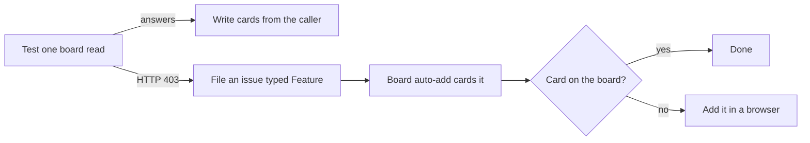

# Project board cards without org access

An org's project board lives at org level, but a script, token or agent session is often limited to repo-scoped endpoints. This guide sets up the board so those callers still get their cards onto it, and says what to check.

## Test it

Read first, so a failure costs nothing: `gh api orgs/<owner>/projectsV2/<n> --jq .title`. A title means the caller can write cards, and `projectsV2/<n>/drafts` files one. HTTP 403 means use the setup below. Org paths and GraphQL are the calls a repo-scoped caller loses. Which callers that covers depends on the tool: for Claude Code, see Claudius [cloud sessions and GitHub](https://github.com/Colorado-Startups/claudius/blob/main/docs/cloud-sessions-github.md).

## Set up the board

| Step | Do |
|---|---|
| 1 | Add an auto-add workflow to the board for the repo, so an issue typed Feature with the `enhancement` label becomes a card |
| 2 | Give each such issue one area label from the repo's list |
| 3 | Group sub-tasks with `POST repos/<owner>/<repo>/issues/<parent>/sub_issues` and `-F sub_issue_id=<id>`. The board shows them under the parent |
| 4 | After filing, read the board. Auto-add can miss: on 2026-11-26 an org board carded some new issues typed Feature and left out others of the same type |
| 5 | Add a missing card in a browser: **Add item**, the repo, tick the issues. Closed issues land as Done, open ones as Todo |
| 6 | List any card still missing in the PR's `To card` table, and say who adds it |

A repo setting, such as the description, also needs a browser when the caller cannot write it, after the claim the org requires.

## Sources

| Fact | Source |
|---|---|
| Repo-scoped callers get 403 on `orgs/` paths | Issue #501 here, and the Claudius guide above |
| Auto-add missed some issues | An org board, read 2026-11-26 |
