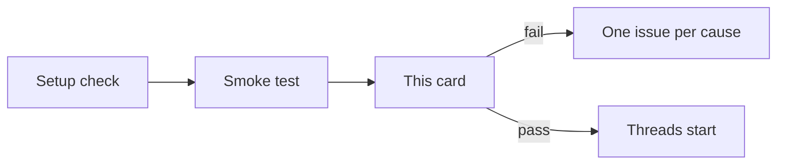

# Setup check result card

Part of the [Projects setup](README.md). The setup check answers pass or fail per line. This card records the answer, so a later thread reads what the project had on a given day.

## The card

Copy the table into the first thread's result file or a pull request. One row per line of the check.

| Area | Line | Result | What I saw | Read (UTC) | Source |
|---|---|---|---|---|---|
| Repos | `<repo>`: `CLAUDE.md` and `AGENTS.md` loaded | ✔ or ✖ | `<what the thread's context showed>` | `<time>` | `<where>` |
| Repos | `<repo>`: push access | ✔ or ✖ | `<dry-run result>` | `<time>` | `<where>` |
| Environment | `<name>`: network, setup script, variable names | ✔ or ✖ | `<names only>` | `<time>` | `<where>` |
| Connectors | `<n>` connected, `<n>` unfinished | ✔ or ✖ | `<names>` | `<time>` | `<where>` |
| GitHub | `<repo>`: rulesets, merge settings | ✔ or ✖ | `<count and rule names>` | `<time>` | `<API path>` |
| Scores | `<page>`: master score | ✔ or ✖ | `<score and build time>` | `<time>` | `<page URL>` |

| Total | Count |
|---|---|
| ✔ pass | `<n>` |
| ✖ fail | `<n>` |
| All lines | `<n>` |

## Rules

| Rule | Detail |
|---|---|
| Result | Pass or fail. A line that was not read is a fail, and its row says so |
| What I saw | The value or message read. Names only for keys, never a value |
| Read | The UTC time of the read, and the page or API path, in the same row |
| A fail | One issue per cause in the repo it belongs to, filed after searching ([tracking.md](tracking.md)) |
| Public repos | No private name, path, key or account detail on a card |

## Sources

Read 2026-11-25: [claude-projects](https://code.claude.com/docs/en/claude-projects) for the first message of a project and the threads it starts.
