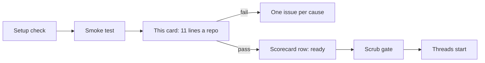
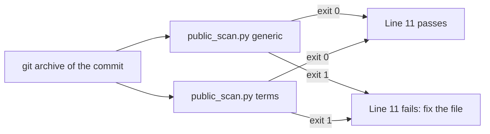

# Setup check result card

Part of the [Projects setup](README.md). The setup check answers pass or fail per line. This card records the answer, so a later thread reads what the project had on a given day. The [readiness scorecard](#readiness-scorecard) rolls every repo's card into one row.

## The card

Copy the table into the first thread's result file or a pull request. One row per line of the check, and the same 11 lines for every repo.

| # | Line | Result | What I saw | Read (UTC) | Source |
|---|---|---|---|---|---|
| 1 | `<repo>`: Claude GitHub App installed | ✔ or ✖ | `<installation listed>` | `<time>` | `<repo settings>` |
| 2 | `<repo>`: attached to the project | ✔ or ✖ | `<project name>` | `<time>` | `<Project settings>` |
| 3 | `<repo>`: `CLAUDE.md` or `AGENTS.md` read | ✔ or ✖ | `<what the thread's context showed>` | `<time>` | `<thread>` |
| 4 | `<repo>`: push access | ✔ or ✖ | `<dry-run result>` | `<time>` | `<thread>` |
| 5 | Environment `<name>`: network access set | ✔ or ✖ | `<access level>` | `<time>` | `<Project settings>` |
| 6 | Setup script empty, or proven by a smoke test | ✔ or ✖ | `<empty, or the gap it fixes>` | `<time>` | `<Project settings>` |
| 7 | Each expected key is a network secret | ✔ or ✖ | `<key names only>` | `<time>` | `<Project settings>` |
| 8 | Connectors: none unfinished | ✔ or ✖ | `<n connected, n unfinished>` | `<time>` | `<thread>` |
| 9 | `<repo>`: default branch requires a pull request and `ci / ci-ok` | ✔ or ✖ | `<ruleset names>` | `<time>` | `<API path>` |
| 10 | `<repo>`: master score read | ✔ or ✖ | `<score and build time>` | `<time>` | `<page URL>` |
| 11 | `<repo>`: scrub gate clean | ✔ or ✖ | `<exit code of each scan>` | `<time>` | `<command>` |

| Total | Count |
|---|---|
| ✔ pass | `<n>` |
| ✖ fail | `<n>` |
| All lines | `<n>` |

Lines 5 to 8 belong to the project, not a repo: read them once. A thread reads lines 1 to 8. The orchestrator reads lines 9 to 11, which need the repo's settings, its page and its tree.

## Rules

| Rule | Detail |
|---|---|
| Result | Pass or fail. A line that was not read is a fail, and its row says so |
| What I saw | The value or message read. Names only for keys, never a value |
| Read | The UTC time of the read, and the page or API path, in the same row |
| A fail | One issue per cause in the repo it belongs to, filed after searching ([tracking.md](tracking.md)) |
| Public repos | No private name, path, key or account detail on a card |

## Readiness scorecard

One row per repo, one column for each of the 11 lines above, in the same order, then a total. A cell is ✔/✖ and nothing else. A repo is ready when all 11 are ✔.

| Repo | App | Attached | Files | Push | Env | Script | Keys | Connectors | Ruleset | Score | Scrub | Ready |
|---|---|---|---|---|---|---|---|---|---|---|---|---|
| `<repo>` | ✔/✖ | ✔/✖ | ✔/✖ | ✔/✖ | ✔/✖ | ✔/✖ | ✔/✖ | ✔/✖ | ✔/✖ | ✔/✖ | ✔ or ✖ | `<n>` of 11 |
| Repos ready | | | | | | | | | | | | `<n>` of `<n>` |

| Rule | Detail |
|---|---|
| Source | Each cell copies the result of the same-numbered line on that repo's card. Columns 5 to 8 repeat the project's single read on every row |
| Date | The card's read time heads the scorecard. A cell older than a day is read again |
| Master score | Column 10 passes when the repo's Quality, Speed and Consumption page loads and states a master score. The score itself goes on the card's row, never in the cell |
| Order | Rows by `Ready`, lowest first, so the work to do leads |

## Scrub gate

Line 11 passes when both scans exit 0 on the repo's tracked files. Run them on a clean export of the commit, so an untracked file never reads as the repo's.

| Scan | Command, from a Git Crafter checkout | Finds |
|---|---|---|
| Generic | `python3 -I tools/public_scan.py generic <export> [allow.txt]` | An email other than `noreply` or an example address, a `/Users/<name>` path other than a placeholder, a key-shaped string |
| Terms | `python3 -I tools/public_scan.py terms <export> <terms-file>` | Each term in a private list you keep outside the repo, as whole words |

| Exit | Meaning |
|---|---|
| 0 | Nothing found |
| 1 | A finding: the scan prints `path:line` and the kind, never the line or the term |
| 2 | Usage error |
| 3 | Could not read the folder or the terms file: the line is a fail |

| Rule | Detail |
|---|---|
| Fix, never allow | A finding is removed from the file. `allow.txt` holds only a published contact address |
| Placeholders | `/Users/someone`, `/Users/x`, `/Users/Shared` and `/Users/runner` read as placeholders |
| Before a commit | Scan the lines you add, not only the tree. A card or scorecard posted in a public repo passes this gate first |
| In CI | `secret-scan.yml` runs gitleaks and the private-term scan on every pull request |

## Sources

Read 2026-11-25: [claude-projects](https://code.claude.com/docs/en/claude-projects) for the first message of a project and the threads it starts.
