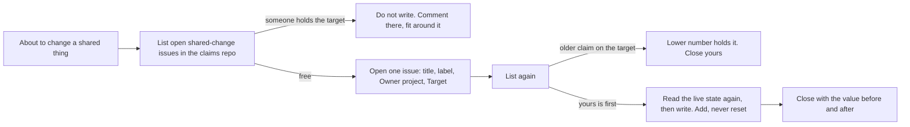

# Coordination: several Code Projects, one set of repos

Use this when more than one Claude Code Project works on the same repos or settings. A project cannot see another project's sessions, so GitHub is the shared place. Paste the row from [instructions.md](instructions.md) into each project.

| Step | Do |
|---|---|
| 1. Look | Before you change a shared thing, list the open issues labelled `shared-change` in the claims repo |
| 2. Held | An open issue on the same target is a claim. Do not write. Comment there and fit around it |
| 3. Claim | Free: open one issue. Title `Shared change: <target>: <what>`, label `shared-change`, and two lines first in the body: `Owner project: <project>` and `Target: <repo or setting>`. Set the org issue fields Owner project and Target in the same call when the org has them. Then list again: if an older open claim on the same target is there, the lower number holds it and yours closes as not planned |
| 4. Write | Read the live state again just before the write. Add, never reset. Change only the lines your claim names |
| 5. Close | In one update: the value before and after, closed as completed. Open means claimed. Closed means done. Never stop with a claim open without saying in it what is left |
| 6. Stale | An open claim with no update for 24 hours is still a claim. Comment on it and tell the person who runs your project. Never take it over |

| Fill in | Example |
|---|---|
| Claims repo | `<org>/<repo>`: one repo for the whole org, private if any target is internal, so one list holds every claim |
| Shared things | The cloud environment, org defaults, rulesets, org and repo switches, board fields, views and workflows, labels, issue fields, scheduled tasks, user-level Claude settings |

## In a repo

| Rule | Why |
|---|---|
| Your own `claude/` branch. A cloud thread clones into its own sandbox, so it needs no worktree. A thread on a Mac folder uses its own worktree | Two sessions in one folder overwrite each other |
| Bring your branch up to date with the base by merging it in. Never force-push, never rewrite pushed history | Another session may hold the branch |
| A PR, issue or card another session opened stays as it is. If your work overlaps it, comment there and link yours | It is theirs |
| Shared settings: add and never reset. A host, variable, rule or task you did not add stays | A reset undoes another project's change |
| Write issues, comments and PRs one at a time. On a secondary rate limit, stop those writes for the time GitHub names and carry on with the work | Every session of the account shares one limit |

## Why this shape

| Question | The page says | Page, read 2026-11-25 | What follows |
|---|---|---|---|
| Can a project reach another | "A project belongs to one user." and "A thread belongs to the one project that started it." No message route between projects | Claude Code, Projects | The rule sits in GitHub and in each project's instructions |
| Can a cloud session reach a board | "Claude can't reach GitHub APIs that exist only in GraphQL, such as Projects v2, through the proxy." | Claude Code, cloud environments | An issue is the claim, set over REST. A board is only the view |
| Is the environment shared | On a network change, "its existing sessions follow the new setting within about a minute." | Claude Code, cloud environments | An environment edit reaches other projects' running sessions, so it is a shared change |
| Where do Owner project and Target live | Up to 25 issue fields per org, applied across all repositories | GitHub, managing issue fields | Org-level issue fields, so a claim from a cloud session carries them. A project-only field would stay empty |
| How does a claim reach the board | "Existing items matching your criteria will not be added." One workflow filters on a label and targets a repo | GitHub, adding items automatically | One auto-add workflow on the label. Claims that exist before it are added once by hand |
| Is a claim a lock | No page offers a lock, and two sessions can both look and both open | None | List again after opening. The lower number holds the target |

Sources: [Claude Code, Projects](https://code.claude.com/docs/en/claude-projects), [Claude Code, cloud environments](https://code.claude.com/docs/en/cloud-environments), [GitHub, managing issue fields](https://docs.github.com/en/issues/tracking-your-work-with-issues/using-issues/managing-issue-fields-in-your-organization), [GitHub, adding items automatically](https://docs.github.com/en/issues/planning-and-tracking-with-projects/automating-your-project/adding-items-automatically).
