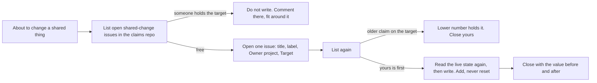

# Coordination: several Code Projects, one set of repos

Use this when more than one Claude Code Project works on the same repos or settings. A project cannot see another project's sessions, so GitHub is the shared place. Paste the row from [instructions.md](instructions.md) into each project.

| Step | Do |
|---|---|
| 1. Look | List the open `shared-change` issues in the claims repo |
| 2. Held | An open issue on your target is a claim. Do not write. Comment there and fit around it |
| 3. Claim | Open one issue: title `Shared change: <target>: <what>`, label `shared-change`, first body lines `Owner project: <project>` and `Target: <repo or setting>`. Set the org issue fields of the same names in the same call. List again: an older open claim on your target holds it, so close yours as not planned |
| 4. Write | Read the live state again just before the write. Add, never reset. Change only what your claim names |
| 5. Close | In one update: the value before and after, closed as completed. Open means claimed, closed means done. Stopping early: say in the claim what is left |
| 6. Stale | An open claim silent for 24 hours is still a claim. Comment on it and tell the person who runs your project. Never take it over |

| Fill in | Value |
|---|---|
| Claims repo | `<org>/<repo>`, one for the whole org and private if any target is internal, so one list holds every claim |
| Shared things | The cloud environment, org defaults, rulesets, repo switches, board fields, views and workflows, labels, issue fields, scheduled tasks, user-level Claude settings |

## In a repo

| Rule | Why |
|---|---|
| Your own `claude/` branch. A Mac folder gets its own worktree. A cloud thread has its own sandbox | Two sessions in one folder overwrite each other |
| Bring your branch up to date by merging the base in. Never force-push | Another session may hold the branch |
| A PR, issue or card another session opened stays as it is: comment and link yours | It is theirs |
| Shared settings: add, never reset | A reset undoes another project's change |
| Write issues, comments and PRs one at a time. On a secondary rate limit, stop those writes for the time GitHub names | Every session of the account shares one limit |

The docs behind each choice: [coordination-sources.md](coordination-sources.md).
