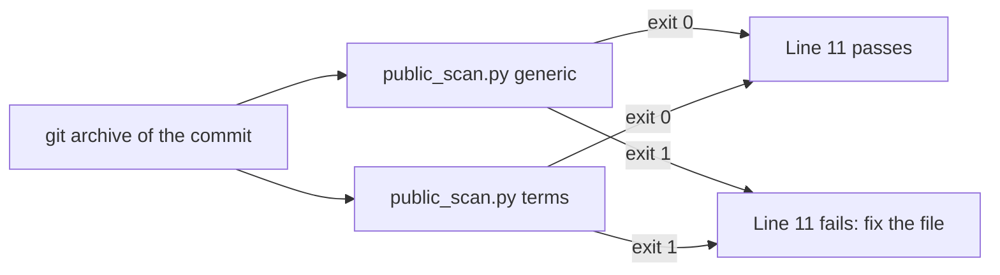

# Scrub gate

Part of the [Projects setup](README.md). Line 11 of the [result card](check-card.md) and the last column of the [scorecard](scorecard.md) read this gate.

Line 11 passes when both scans exit 0 on the repo's tracked files. Run them on a clean export of the commit, so an untracked file never reads as the repo's.

| Scan | Command, from a Git Crafter checkout | Finds |
|---|---|---|
| Generic | `python3 -I tools/public_scan.py generic <export> [allow.txt]` | An email other than `noreply` or an example address, a `/Users/<name>` path other than a placeholder, a key-shaped string |
| Terms | `python3 -I tools/public_scan.py terms <export> <terms-file>` | Each term in a private list you keep outside the repo, as whole words |

| Exit | Meaning |
|---|---|
| 0 | Nothing found |
| 1 | A finding: the scan prints `path:line` and the kind, never the line or the term |
| 2 | Usage error |
| 3 | Could not read the folder or the terms file: the line is a fail |

| Rule | Detail |
|---|---|
| Fix, never allow | A finding is removed from the file. `allow.txt` holds only a published contact address |
| Placeholders | `/Users/someone`, `/Users/x`, `/Users/Shared` and `/Users/runner` read as placeholders |
| Before a commit | Scan the lines you add, not only the tree. A card or scorecard posted in a public repo passes this gate first |
| In CI | `secret-scan.yml` runs gitleaks and the private-term scan on every pull request |
