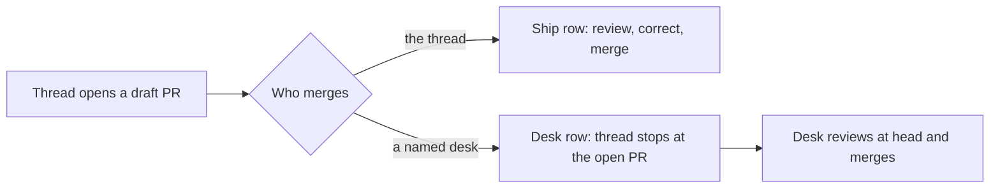

# Ship variants

Part of the [Projects setup](README.md). Linked from the Ship row of [instructions.md](instructions.md).

## One branch, one owner

| Rule | Detail |
|---|---|
| Push | Only your own branch. A brief cannot hand a thread another thread's branch to amend |
| Change a predecessor's work | Open a new pull request that supersedes it, and link the old one |

## Ship with a merge desk

Use this row in place of Ship when one named desk must merge and every other thread stops at its open pull request.

| Every thread | Do |
|---|---|
| Ship | Branch `claude/<topic>`. Draft PR within 10 minutes. Push each step. On green CI, stop at the open PR and post its head SHA. The desk `<desk name>` reviews at head, corrects, posts `Review: MERGE at <40-hex sha>`, sets the `review` status as in the Ship row, and merges with the head SHA as its guard. Never `--admin`, push to `<default branch>`, force-push or hard-reset |
