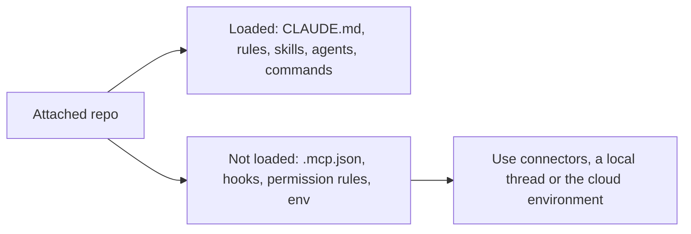

# Cloud threads: what loads and what limits

Part of the [Projects setup](README.md). Linked from [instructions.md](instructions.md).

## What a cloud thread loads

A thread clones each attached repo. It does not read everything in `.claude/`.

| In the repo | Cloud thread | If you need it |
|---|---|---|
| `CLAUDE.md`, and the `.claude/` folder's own CLAUDE.md and rules | Loaded. Path-specific rules wait | |
| Skills, agents, commands | Loaded | A dot-named repo skips them: run the thread as a Remote Control session |
| `.mcp.json` servers | Not loaded | Use your account's connectors |
| Hooks and permission rules in `.claude/settings.json` | Not run | Use a local thread |
| `env` in `.claude/settings.json` | Not applied | Set it in the cloud environment |

## Subagents

A thread keeps its context small by sending wide reads and reviews to a subagent in `.claude/agents/`. Each names its model, so none inherits the thread's.

| Agent | Model | Tools | Use |
|---|---|---|---|
| `Explore` | Haiku 5.5 | Read, Grep, Glob, Bash, WebFetch, WebSearch | A search across many files or a CI log: only the answer comes back |
| `reviewer` | Sonnet 5.5 | Read, Grep, Glob, Bash | One fresh review per pull request at its head commit, read only: `MERGE` or `BLOCK` and each fix ([reviewing.md](../../skills/merging/reviewing.md)) |

## Limits and cost

Projects need a Pro, Max or Ultra plan, not Team or Enterprise. The thread limit, the cache, models, pull request watching, usage limits and each spend guard are kept in one place: Compute Crafter's [Claude Code Projects spend guards](https://github.com/SoulCraft-Org/compute-crafter/blob/main/docs/claude-code-projects-spend.md). Read the figures there, not a copy here.

## Limits seen in a setup run

Seen 2026-11-25 in a project setup run. Check against the current docs before relying on it.

| Limit | Do |
|---|---|
| Adding a repo to a running thread stops that thread's next message to the coordinator until the owner confirms trust in the app | Attach the repo before the thread starts |

## Scoring

Each tab has a Quality, Speed and Consumption page and a map: [pages.md](pages.md).
